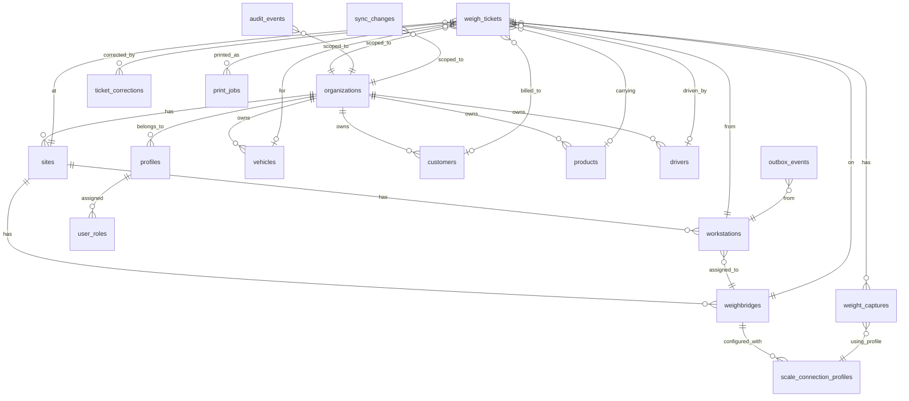

# Augment Scale — Database Design

## Goal

Design the complete database schema for Augment Scale — a weighbridge system replacing an old VB6 + Access app. The design covers two databases that describe the same records the same way:

1. **Local** — encrypted SQLite on the cabin PC (fast, offline-first)
2. **Cloud** — Supabase PostgreSQL (canonical once synced, admin portal reads this)

The design must be light enough for old cabin PCs, work with zero internet, and produce trustworthy, traceable, tamper-resistant records.

---

## User Review Required

> [!IMPORTANT]
> **This is a design-only document.** No code will be written until you approve it. Review the tables, fields, and decisions below, then tell me what to change or confirm.

---

## Open Questions

> [!IMPORTANT]
> **Q1 — One-weigh tickets.** The PRD mentions "one or more captures per ticket" and the old system has records where only one weight was ever recorded. Does the business currently use **one-weigh-only** tickets (e.g., just a gross weight, no return), or are these always incomplete two-weigh cycles where the truck simply never came back? This affects whether `status = 'completed_single'` is a legitimate final state.

> [!IMPORTANT]
> **Q2 — Challan / Gate Pass.** The prototype has a `challan` field. Confirm this is a string reference number to keep as an optional ticket field.

> [!IMPORTANT]
> **Q3 — Weight unit.** The scale reader supports 0–4 decimal places. Should the database store the raw integer digits + decimal count (most precise), or a pre-divided decimal value?
> **My recommendation:** Store both — the raw integer digits and decimal count (for metrological proof), plus a computed `REAL` value for queries. I'll explain below.

> [!IMPORTANT]
> **Q4 — Multi-site / multi-weighbridge.** The PRD references `organizations`, `sites`, `weighbridges`. For Phase 1 (single cabin, single scale), I still create these tables but the site will start with one row each. Confirm this is acceptable, or if you want to simplify Phase 1 by inlining `site_id` / `weighbridge_id` as plain text config instead.

---

## Resolved Decisions — History, Trucks & Reprint

The History / Trucks / Reprint work resolved these schema decisions:

1. **Archive is soft delete.** `vehicles.deleted_at` + `deleted_by` + new `deleted_reason` represent archive; `active` / `archived` is derived.
2. **Truck list stats are cached.** `trip_count`, `last_weighed_at`, and `last_tare_kg` are maintained on completion and void, and can be rebuilt from `weigh_tickets`.
3. **Keep both history dates.** `business_at` drives the default History filter/sort; `last_status_at` records the latest lifecycle event (void / delete / complete / create).
4. **Plate is lifetime-unique.** A vehicle plate cannot be reused after archive; restoring the row is the only way to bring it back.
5. **`print_count` is derived.** It is derived from `print_jobs` for the ticket's current document type, not stored on `weigh_tickets`.

> [!NOTE]
> Q1 (one-weigh-only tickets) remains open. The History screen's "First only" stage is an incomplete/deleted state, not a new `completed_single` ticket status.

---

## Research Summary

### What I studied

| Source | Key takeaway |
|--------|-------------|
| [draft-prd.md](file:///Users/shawon/Documents/weight-scale/weight-scale-onsite-testing-report/scale/draft-prd.md) | Full architecture: C# + WebView2 desktop, Next.js admin portal, encrypted SQLite local, Supabase PostgreSQL cloud, outbox/inbox sync, audit triggers, RLS |
| [legacy_apps_user_flow/README.md](file:///Users/shawon/Documents/weight-scale/weight-scale-onsite-testing-report/scale/legacy_apps_user_flow/README.md) | Two-step flow: "Weight Add" (first weigh) → "Net Weight" (second weigh). IN WEIGHT = loaded first, OUT WEIGHT = empty first |
| Legacy Access `.mdb` | Used as **domain reference only** (field names, business concepts, weighing vocabulary). No schema matching or data migration planned. |
| [state.js](file:///Users/shawon/Documents/weight-scale/weight-scale-onsite-testing-report/scale/prototype/js/state.js) | Prototype model: pending/completed/voided/deleted ticket collections; `printCount`/`printLog`; derived status/stage helpers; write-only `actionLog`; truck archive fields (`status`, `archivedAt/By/Reason`) and cached `tripCount`/`lastWeighed`/`lastTare` |
| [first-weigh.js](file:///Users/shawon/Documents/weight-scale/weight-scale-onsite-testing-report/scale/prototype/js/screens/first-weigh.js) | Commit creates: `{id, truckNo, driver, material, client, phone, challan, remarks, weightType, firstWeight, firstWeightType, firstWeightTime, firstOperator}`; archived plates are excluded from autocomplete |
| [second-weigh.js](file:///Users/shawon/Documents/weight-scale/weight-scale-onsite-testing-report/scale/prototype/js/screens/second-weigh.js) | Second weigh adds: `grossWeight, tareWeight, netWeight, secondTime, secondOperator`, plus optional `override` object `{reason, operator, timestamp, anomalyDetails}` |
| [print.js](file:///Users/shawon/Documents/weight-scale/weight-scale-onsite-testing-report/scale/prototype/js/print.js) | Slip/certificate uses stored ticket values; reprint stamps a duplicate copy, requires a reason, and appends to `printLog` |
| [seed-data.js](file:///Users/shawon/Documents/weight-scale/weight-scale-onsite-testing-report/scale/prototype/js/seed-data.js) | Deterministic 30-day demo ledger: completed, voided, and deleted-pending ticket shapes with print history |
| [History_Truck_Reprint_Plan.md](file:///Users/shawon/Documents/weight-scale/weight-scale-onsite-testing-report/scale/prototype/docs/History_Truck_Reprint_Plan.md) | History ledger, truck archive/restore, reprint copy tracking, void rules, and action logging |
| [XK3190 Scale Reader](file:///Users/shawon/Documents/weight-scale/weight-scale-onsite-testing-report/scale/XK3190_Scale_Reader/TESTING_AND_ANALYSIS_REPORT.md) | 12-byte frame: `STX + sign + 6 ASCII digits + decimal_count(0-4) + 2-char XOR checksum + ETX`. Value = digits ÷ 10^decimal_count |
| [ARCHITECTURE.md](file:///Users/shawon/Documents/weight-scale/weight-scale-onsite-testing-report/scale/prototype/docs/codebase/ARCHITECTURE.md) | Prototype is in-memory only, no persistence. C# backend will own SQLite |
| PRD §8 Data Model | Lists: organizations, sites, weighbridges, workstations, scale_connection_profiles, profiles, user_roles, weigh_tickets, weight_captures, scale_health_events, ticket_corrections, print_jobs, audit_events, sync_changes, device_events |

---

## Design Principles

1. **Same shape, both databases.** The local SQLite and cloud PostgreSQL schemas use identical table names, column names, and types wherever possible. Differences are documented explicitly.
2. **UUIDs everywhere.** All primary keys are UUIDs (TEXT in SQLite, `uuid` in PostgreSQL). Sequential ticket numbers are a separate human-facing field, not the PK.
3. **Immutable weights.** Once a weight capture is finalized, its values are never updated. Corrections create new linked records.
4. **Append-only audit.** The `audit_events` table has no UPDATE or DELETE permissions. Every mutation to any business table produces an audit row in the same transaction.
5. **Sync by outbox.** Local writes go to an `outbox_events` table. The sync worker sends them to the cloud. The cloud writes to `sync_changes`. Local pulls from `sync_changes` using a saved cursor.
6. **Soft delete only.** No business row is ever physically deleted. Soft-delete uses `deleted_at` / `deleted_by`.
7. **Metrological evidence.** Every weight capture stores the raw frame bytes, decoded digits, decimal count, checksum status, and stability evidence — enough to independently reproduce the displayed value.
8. **Derived reads, stored evidence.** History display status, weigh stage, history timestamps, and print counts are derived from immutable ticket/print rows; truck list statistics are derived caches. They are not independent sources of truth.
9. **Archive is soft delete.** Vehicles are archived by setting `deleted_at` / `deleted_by` / `deleted_reason`; the UI's `active` / `archived` state is derived. Plate numbers are lifetime-unique per organization.

---

## Entity-Relationship Diagram



> [!NOTE]
> `ticket_history` is a derived view over `weigh_tickets` and `print_jobs`, so it is not shown in the ERD.

---

## Table Definitions

### Notation

- **PK** = primary key
- **FK** = foreign key
- **NN** = NOT NULL
- **UQ** = UNIQUE
- **View** = read-only derived relation, not a stored table
- SQLite types: `TEXT`, `INTEGER`, `REAL`, `BLOB`
- PostgreSQL types shown in parentheses where they differ

---

### 1. `organizations`

The top-level tenant. Single row for Phase 1, multi-tenant ready.

| Column | Type | Constraints | Description |
|--------|------|-------------|-------------|
| `id` | TEXT (uuid) | PK | |
| `name` | TEXT | NN | e.g. "Meghna Ship Recycling" |
| `address` | TEXT | | |
| `phone` | TEXT | | |
| `email` | TEXT | | |
| `logo_url` | TEXT | | For printed slips / portal |
| `settings` | TEXT (jsonb) | | Org-wide defaults (offline lease duration, ticket number prefix, etc.) |
| `created_at` | TEXT (timestamptz) | NN | |
| `updated_at` | TEXT (timestamptz) | NN | |

---

### 2. `sites`

A physical location with one or more weighbridges.

| Column | Type | Constraints | Description |
|--------|------|-------------|-------------|
| `id` | TEXT (uuid) | PK | |
| `organization_id` | TEXT (uuid) | FK → organizations, NN | |
| `name` | TEXT | NN | e.g. "Main Yard" |
| `address` | TEXT | | |
| `timezone` | TEXT | NN | e.g. "Asia/Dhaka" |
| `created_at` | TEXT (timestamptz) | NN | |
| `updated_at` | TEXT (timestamptz) | NN | |
| `deleted_at` | TEXT (timestamptz) | | Soft delete |
| `deleted_by` | TEXT (uuid) | | FK → profiles |

---

### 3. `weighbridges`

A physical scale platform at a site.

| Column | Type | Constraints | Description |
|--------|------|-------------|-------------|
| `id` | TEXT (uuid) | PK | |
| `site_id` | TEXT (uuid) | FK → sites, NN | |
| `name` | TEXT | NN | e.g. "Weighbridge 1" |
| `max_capacity_kg` | INTEGER | | |
| `min_division_kg` | INTEGER | | e.g. 5 (the smallest graduation) |
| `created_at` | TEXT (timestamptz) | NN | |
| `updated_at` | TEXT (timestamptz) | NN | |
| `deleted_at` | TEXT (timestamptz) | | |
| `deleted_by` | TEXT (uuid) | | |

---

### 4. `scale_connection_profiles`

The approved hardware configuration. Changes are audited. COM1/9600/8N1/format-1 is the initial profile.

| Column | Type | Constraints | Description |
|--------|------|-------------|-------------|
| `id` | TEXT (uuid) | PK | |
| `weighbridge_id` | TEXT (uuid) | FK → weighbridges, NN | |
| `port_name` | TEXT | NN | e.g. "COM1" |
| `baud_rate` | INTEGER | NN | e.g. 9600 |
| `data_bits` | INTEGER | NN | e.g. 8 |
| `parity` | TEXT | NN | "None" / "Even" / "Odd" |
| `stop_bits` | INTEGER | NN | e.g. 1 |
| `protocol_format` | TEXT | NN | e.g. "yaohua_format_1" |
| `stability_window_ms` | INTEGER | NN | e.g. 500 |
| `stability_tolerance_kg` | REAL | NN | Max variance to declare stable |
| `effective_from` | TEXT (timestamptz) | NN | |
| `effective_to` | TEXT (timestamptz) | | NULL = current |
| `version` | INTEGER | NN | Incrementing version for this weighbridge |
| `approved_by` | TEXT (uuid) | FK → profiles | |
| `change_reason` | TEXT | | |
| `created_at` | TEXT (timestamptz) | NN | |

> [!NOTE]
> **Cloud vs local difference:** The local SQLite only stores profiles for its own assigned weighbridge. The cloud stores all profiles for all weighbridges. Sync pulls the relevant profiles down.

---

### 5. `workstations`

A registered cabin PC.

| Column | Type | Constraints | Description |
|--------|------|-------------|-------------|
| `id` | TEXT (uuid) | PK | |
| `organization_id` | TEXT (uuid) | FK → organizations, NN | |
| `site_id` | TEXT (uuid) | FK → sites, NN | |
| `weighbridge_id` | TEXT (uuid) | FK → weighbridges, NN | |
| `hostname` | TEXT | | Windows machine name |
| `device_key_thumbprint` | TEXT | | Phase 2: TPM/cert thumbprint |
| `registered_at` | TEXT (timestamptz) | NN | |
| `last_seen_at` | TEXT (timestamptz) | | |
| `settings` | TEXT (jsonb) | | Workstation-specific overrides |
| `created_at` | TEXT (timestamptz) | NN | |
| `updated_at` | TEXT (timestamptz) | NN | |

> [!NOTE]
> **Local-only column:** `last_seen_at` is updated locally on every app start and synced to cloud for device health monitoring.

---

### 6. `profiles`

Maps to Supabase Auth users. One row per person.

| Column | Type | Constraints | Description |
|--------|------|-------------|-------------|
| `id` | TEXT (uuid) | PK | Same as Supabase `auth.users.id` |
| `organization_id` | TEXT (uuid) | FK → organizations, NN | |
| `display_name` | TEXT | NN | e.g. "MD. RAJU" |
| `first_name` | TEXT | | |
| `initials` | TEXT | | e.g. "MR" |
| `avatar_url` | TEXT | | |
| `color` | TEXT | | UI accent color |
| `shift` | TEXT | | e.g. "Shift A" |
| `is_active` | INTEGER (boolean) | NN, DEFAULT 1 | |
| `created_at` | TEXT (timestamptz) | NN | |
| `updated_at` | TEXT (timestamptz) | NN | |
| `deleted_at` | TEXT (timestamptz) | | |
| `deleted_by` | TEXT (uuid) | | |

> [!NOTE]
> **Cloud vs local difference:** Authentication (password, JWT, MFA) lives exclusively in Supabase Auth — never in SQLite. The local database stores only the profile metadata needed for offline display and role checks. PINs (if used for quick-switch) would be hashed and stored locally by the C# layer using DPAPI, **not** in this table.

---

### 7. `user_roles`

Role assignments scoped to an organization and optionally a site.

| Column | Type | Constraints | Description |
|--------|------|-------------|-------------|
| `id` | TEXT (uuid) | PK | |
| `profile_id` | TEXT (uuid) | FK → profiles, NN | |
| `organization_id` | TEXT (uuid) | FK → organizations, NN | |
| `site_id` | TEXT (uuid) | FK → sites | NULL = all sites |
| `role` | TEXT | NN | `operator`, `supervisor`, `administrator`, `viewer`, `auditor` |
| `granted_at` | TEXT (timestamptz) | NN | |
| `granted_by` | TEXT (uuid) | FK → profiles | |
| `revoked_at` | TEXT (timestamptz) | | |
| `revoked_by` | TEXT (uuid) | | |

> [!NOTE]
> A profile can have multiple roles (e.g., operator at one site, supervisor at another). The `role` column is an enum-like TEXT validated by the application, not a foreign key to a roles table — this keeps it simple given the small, fixed role set.

---

### 8. `vehicles`

Master data. The prototype's `REGISTERED_TRUCKS` array.

| Column | Type | Constraints | Description |
|--------|------|-------------|-------------|
| `id` | TEXT (uuid) | PK | |
| `organization_id` | TEXT (uuid) | FK → organizations, NN | |
| `plate_number` | TEXT | NN | e.g. "DM-T-11-2045" |
| `plate_normalized` | TEXT | NN | Uppercase, stripped punctuation; unique per organization for the vehicle's lifetime |
| `default_driver_name` | TEXT | | Pre-fill convenience |
| `default_driver_phone` | TEXT | | |
| `default_client` | TEXT | | |
| `default_material` | TEXT | | |
| `notes` | TEXT | | |
| `trip_count` | INTEGER | NN, DEFAULT 0 | Derived cache: completed, non-voided, non-deleted tickets |
| `last_weighed_at` | TEXT (timestamptz) | | Derived cache: latest completed, non-voided ticket |
| `last_tare_kg` | REAL | | Derived cache: tare of the latest completed, non-voided ticket |
| `registered_by` | TEXT (uuid) | FK → profiles | Immutable; set at registration |
| `updated_by` | TEXT (uuid) | FK → profiles | Last editor |
| `row_version` | INTEGER | NN, DEFAULT 1 | Optimistic concurrency |
| `created_at` | TEXT (timestamptz) | NN | Registration time |
| `updated_at` | TEXT (timestamptz) | NN | |
| `deleted_at` | TEXT (timestamptz) | | Archive time; NULL = active |
| `deleted_by` | TEXT (uuid) | FK → profiles | Who archived it |
| `deleted_reason` | TEXT | | Archive reason; required when `deleted_at` is set |

> [!NOTE]
> **Archive / restore.** The Trucks screen's `active` / `archived` status is derived from `deleted_at`. Archive sets `deleted_at`, `deleted_by`, and `deleted_reason`; restore clears them. Archiving is blocked while an open pending ticket exists for the plate (`weigh_tickets.status = 'pending' AND deleted_at IS NULL`).
>
> **Derived counters.** `trip_count`, `last_weighed_at`, and `last_tare_kg` are caches maintained in the same transaction as ticket completion/void. On void, decrement `trip_count` and recompute the last values from the latest remaining completed, non-voided ticket. They can always be rebuilt from `weigh_tickets`.
>
> **One identity per plate.** `UNIQUE (organization_id, plate_normalized)` applies to all rows, including archived ones. Re-adding an archived plate restores the existing row; it must not create a second vehicle with the same plate. `registered_by` / `created_at` are immutable; edits write `updated_by` / `updated_at`.

---

### 9. `customers`

Clients / parties / buyers / sellers. Replaces legacy `company` table + the free-text fields.

| Column | Type | Constraints | Description |
|--------|------|-------------|-------------|
| `id` | TEXT (uuid) | PK | |
| `organization_id` | TEXT (uuid) | FK → organizations, NN | |
| `name` | TEXT | NN | e.g. "BSRM Steels Ltd" |
| `address` | TEXT | | |
| `phone` | TEXT | | |
| `email` | TEXT | | |
| `customer_type` | TEXT | | "buyer", "seller", "both", or NULL |
| `row_version` | INTEGER | NN, DEFAULT 1 | |
| `created_at` | TEXT (timestamptz) | NN | |
| `updated_at` | TEXT (timestamptz) | NN | |
| `deleted_at` | TEXT (timestamptz) | | |
| `deleted_by` | TEXT (uuid) | | |

---

### 10. `products`

Materials / commodities. Replaces legacy `matrial` table.

| Column | Type | Constraints | Description |
|--------|------|-------------|-------------|
| `id` | TEXT (uuid) | PK | |
| `organization_id` | TEXT (uuid) | FK → organizations, NN | |
| `code` | TEXT | | Legacy material code, e.g. "1" |
| `name` | TEXT | NN | e.g. "Scrap Iron", "MS Plate", "Pipe" |
| `description` | TEXT | | |
| `display_order` | INTEGER | | For quick-pick pill ordering |
| `is_quick_pick` | INTEGER (boolean) | DEFAULT 0 | Show as quick-pick pill in UI |
| `row_version` | INTEGER | NN, DEFAULT 1 | |
| `created_at` | TEXT (timestamptz) | NN | |
| `updated_at` | TEXT (timestamptz) | NN | |
| `deleted_at` | TEXT (timestamptz) | | |
| `deleted_by` | TEXT (uuid) | | |

---

### 11. `drivers`

Optional master data. Currently free-text in prototype; this table enables autocomplete and history.

| Column | Type | Constraints | Description |
|--------|------|-------------|-------------|
| `id` | TEXT (uuid) | PK | |
| `organization_id` | TEXT (uuid) | FK → organizations, NN | |
| `name` | TEXT | NN | |
| `phone` | TEXT | | |
| `license_number` | TEXT | | |
| `row_version` | INTEGER | NN, DEFAULT 1 | |
| `created_at` | TEXT (timestamptz) | NN | |
| `updated_at` | TEXT (timestamptz) | NN | |
| `deleted_at` | TEXT (timestamptz) | | |
| `deleted_by` | TEXT (uuid) | | |

---

### 12. `weigh_tickets` ⭐ (core business table)

The ticket header. One row per weighing cycle (first weigh → second weigh).

| Column | Type | Constraints | Description |
|--------|------|-------------|-------------|
| `id` | TEXT (uuid) | PK | Globally unique |
| `organization_id` | TEXT (uuid) | FK → organizations, NN | |
| `site_id` | TEXT (uuid) | FK → sites, NN | |
| `weighbridge_id` | TEXT (uuid) | FK → weighbridges, NN | |
| `workstation_id` | TEXT (uuid) | FK → workstations, NN | Cabin PC that created it |
| `ticket_number` | INTEGER | NN | Human-facing sequential number, unique per org+site |
| `ticket_display_id` | TEXT | NN | Formatted: e.g. "I-11353" or "O-11353" |
| `direction` | TEXT | NN | `IN` or `OUT` |
| `status` | TEXT | NN | `pending`, `completed`, `voided`; deleted pending is `pending` + `deleted_at` |
| `vehicle_id` | TEXT (uuid) | FK → vehicles | NULL if ad-hoc plate |
| `plate_number` | TEXT | NN | Denormalized for offline display + search |
| `product_id` | TEXT (uuid) | FK → products | |
| `product_name` | TEXT | | Denormalized snapshot |
| `customer_id` | TEXT (uuid) | FK → customers | |
| `customer_name` | TEXT | | Denormalized snapshot |
| `driver_id` | TEXT (uuid) | FK → drivers | |
| `driver_name` | TEXT | | Denormalized snapshot |
| `driver_phone` | TEXT | | |
| `challan` | TEXT | | Gate pass / challan reference |
| `remarks` | TEXT | | Free-text notes |
| `first_weight_kg` | REAL | | The weight value captured at first weigh |
| `first_weight_type` | TEXT | | `gross` or `tare` (derived from direction) |
| `first_weight_at` | TEXT (timestamptz) | | Timestamp of first capture |
| `first_weight_capture_id` | TEXT (uuid) | FK → weight_captures | Link to the metrological evidence |
| `first_operator_id` | TEXT (uuid) | FK → profiles | |
| `first_operator_name` | TEXT | | Denormalized snapshot |
| `second_weight_kg` | REAL | | The weight value captured at second weigh |
| `second_weight_type` | TEXT | | `gross` or `tare` |
| `second_weight_at` | TEXT (timestamptz) | | Timestamp of second capture |
| `second_weight_capture_id` | TEXT (uuid) | FK → weight_captures | |
| `second_operator_id` | TEXT (uuid) | FK → profiles | |
| `second_operator_name` | TEXT | | Denormalized snapshot |
| `gross_weight_kg` | REAL | | Computed: the larger of the two |
| `tare_weight_kg` | REAL | | Computed: the smaller of the two |
| `net_weight_kg` | REAL | | `abs(gross - tare)` |
| `is_overridden` | INTEGER (boolean) | DEFAULT 0 | Second weigh had anomaly override |
| `override_reason` | TEXT | | |
| `override_operator_id` | TEXT (uuid) | | Who authorized the override |
| `override_operator_name` | TEXT | | Snapshot for print/audit |
| `override_anomaly_details` | TEXT | | Human-readable anomaly context |
| `override_at` | TEXT (timestamptz) | | |
| `completed_at` | TEXT (timestamptz) | | When second weigh was finalized |
| `voided_at` | TEXT (timestamptz) | | |
| `voided_by` | TEXT (uuid) | FK → profiles | |
| `voided_reason` | TEXT | | |
| `row_version` | INTEGER | NN, DEFAULT 1 | Optimistic concurrency for sync |
| `created_at` | TEXT (timestamptz) | NN | |
| `created_by` | TEXT (uuid) | FK → profiles, NN | |
| `updated_at` | TEXT (timestamptz) | NN | |
| `updated_by` | TEXT (uuid) | FK → profiles, NN | |
| `deleted_at` | TEXT (timestamptz) | | Soft delete / pending-ticket deletion |
| `deleted_by` | TEXT (uuid) | FK → profiles | |
| `deleted_reason` | TEXT | | Required when `deleted_at` is set |

> [!TIP]
> **Why denormalize names?** A ticket is a business document. When you print a slip, it must show the operator name, material, and client *as they were at the time of weighing* — not the current value in the master data table (which may have changed since). The `_id` columns provide the FK for joins; the `_name` columns are point-in-time snapshots.

> [!NOTE]
> **Why `first_weight_kg` / `second_weight_kg` instead of just `gross` / `tare`?** Because whether the first weight is gross or tare depends on the direction. Storing first/second makes the timeline clear. The `gross_weight_kg`, `tare_weight_kg`, and `net_weight_kg` are computed convenience columns populated when the ticket is completed.

> [!IMPORTANT]
> **Status vs. deletion.** `status` is the lifecycle: `pending`, `completed`, or `voided`. A deleted pending ticket keeps `status = 'pending'` and is marked with `deleted_at` / `deleted_by` / `deleted_reason` — "Deleted" is a display state, not a lifecycle status. Completed tickets are never deleted; they are voided. Enforce `deleted_at IS NULL OR status = 'pending'`.
>
> **Stage is derived.** A ticket is `first` when no second weight exists (`second_weight_capture_id` and `second_weight_kg` are NULL); it is `complete` when the second weight exists. The History screen's "First only" filter is this derived stage, not a stored column.
>
> **History timestamps are derived.** `ticket_history.business_at` (`COALESCE(completed_at, voided_at, deleted_at, created_at)`) drives the default History date filter/sort; `last_status_at` (`COALESCE(voided_at, deleted_at, completed_at, created_at)`) records the latest lifecycle event. Both are exposed by the view in §23.
>
> **Print count is derived.** `print_count` is derived from `print_jobs` for the current document type (certificate for completed/voided, first-weigh slip for pending/deleted) — never stored on the ticket.
>
> **Override snapshots.** `override_operator_name` and `override_anomaly_details` preserve what was printed/displayed at the time of the override.

---

### 13. `weight_captures` ⭐ (metrological evidence)

Every time the scale reading is locked, one row is created. Immutable after creation.

| Column | Type | Constraints | Description |
|--------|------|-------------|-------------|
| `id` | TEXT (uuid) | PK | |
| `ticket_id` | TEXT (uuid) | FK → weigh_tickets, NN | |
| `organization_id` | TEXT (uuid) | FK → organizations, NN | |
| `capture_sequence` | INTEGER | NN | 1 = first capture, 2 = second, etc. (recaptures increment) |
| `is_final` | INTEGER (boolean) | NN | Only the final capture for each weigh step is `true` |
| `weight_kg` | REAL | NN | Decoded and signed value |
| `weight_raw_digits` | TEXT | NN | e.g. "018420" — the 6 raw ASCII digits from the frame |
| `weight_sign` | TEXT | NN | "+" or "-" |
| `decimal_count` | INTEGER | NN | 0–4 from the frame's decimal byte |
| `unit` | TEXT | NN, DEFAULT 'kg' | |
| `raw_frame_hex` | TEXT | | Full 12-byte frame as hex string, e.g. "022B303030303030303142 03" |
| `checksum_valid` | INTEGER (boolean) | NN | |
| `checksum_expected` | TEXT | | 2-char hex |
| `checksum_actual` | TEXT | | 2-char hex |
| `is_stable` | INTEGER (boolean) | NN | Was the reading stable at capture time? |
| `stability_variance` | REAL | | Variance over the stability window |
| `stability_window_ms` | INTEGER | | Window size used |
| `stability_sample_count` | INTEGER | | Number of frames in window |
| `connection_profile_id` | TEXT (uuid) | FK → scale_connection_profiles | Which config was active |
| `connection_profile_version` | INTEGER | | Snapshot of the version |
| `source` | TEXT | NN | `hardware`, `simulator`, `manual_entry` |
| `workstation_id` | TEXT (uuid) | FK → workstations | |
| `operator_id` | TEXT (uuid) | FK → profiles, NN | |
| `captured_at` | TEXT (timestamptz) | NN | Client-side timestamp |
| `created_at` | TEXT (timestamptz) | NN | |

> [!TIP]
> **This table is the metrological proof.** Given `weight_raw_digits`, `weight_sign`, and `decimal_count`, anyone can independently verify: `value = sign × digits ÷ 10^decimal_count`. Combined with `raw_frame_hex` and `checksum_valid`, the entire reading is cryptographically verifiable against the scale's output.

> [!NOTE]
> **Cloud vs local difference:** None. This table is identical in both databases. Captures created offline are synced exactly as-is — they are never modified.

---

### 14. `ticket_corrections`

Append-only. A correction never changes the original ticket weight. It creates a linked record.

| Column | Type | Constraints | Description |
|--------|------|-------------|-------------|
| `id` | TEXT (uuid) | PK | |
| `ticket_id` | TEXT (uuid) | FK → weigh_tickets, NN | |
| `organization_id` | TEXT (uuid) | FK → organizations, NN | |
| `correction_type` | TEXT | NN | `metadata_change`, `weight_reversal`, `void`, `reinstate` |
| `field_changed` | TEXT | | Which field was corrected (for metadata changes) |
| `old_value` | TEXT | | JSON-encoded previous value |
| `new_value` | TEXT | | JSON-encoded new value |
| `reason` | TEXT | NN | Mandatory explanation |
| `requested_by` | TEXT (uuid) | FK → profiles, NN | |
| `requested_at` | TEXT (timestamptz) | NN | |
| `approved_by` | TEXT (uuid) | FK → profiles | NULL if no approval required |
| `approved_at` | TEXT (timestamptz) | | |
| `approval_status` | TEXT | | `pending`, `approved`, `rejected` |
| `created_at` | TEXT (timestamptz) | NN | |

> [!IMPORTANT]
> **Void is a single transaction.** A void updates `weigh_tickets` (`status`, `voided_at`, `voided_by`, `voided_reason`), inserts a `ticket_corrections` row (`correction_type = 'void'`, `reason`, `requested_by`), and writes the audit event together. In the Phase 1 flat-permission model `approved_by` / `approved_at` remain NULL. Deleting a pending ticket is a soft delete + audit event, not a correction.

---

### 15. `print_jobs`

Every print or reprint is logged.

| Column | Type | Constraints | Description |
|--------|------|-------------|-------------|
| `id` | TEXT (uuid) | PK | |
| `ticket_id` | TEXT (uuid) | FK → weigh_tickets, NN | |
| `organization_id` | TEXT (uuid) | FK → organizations, NN | |
| `document_type` | TEXT | NN | `first_weigh_slip` or `weighbridge_certificate` |
| `is_reprint` | INTEGER (boolean) | NN, DEFAULT 0 | 1 for duplicate copies |
| `copy_number` | INTEGER | NN, DEFAULT 1 | 1 = first print; 2+ = reprints |
| `reprint_reason` | TEXT | | Required when `is_reprint = 1` |
| `template_version` | TEXT | | |
| `printed_by` | TEXT (uuid) | FK → profiles, NN | |
| `printed_at` | TEXT (timestamptz) | NN | |
| `workstation_id` | TEXT (uuid) | FK → workstations | |
| `pdf_storage_path` | TEXT | | Supabase Storage path if archived |
| `pdf_hash` | TEXT | | SHA-256 of the generated PDF |
| `created_at` | TEXT (timestamptz) | NN | |

> [!NOTE]
> **Print vs. reprint.** A first print is `copy_number = 1`, `is_reprint = 0`. A reprint is `copy_number >= 2`, `is_reprint = 1`, and requires `reprint_reason`. Reprints are allowed for pending first-weigh slips and completed/voided certificates; deleted tickets cannot be reprinted.
>
> **Uniqueness and counts.** `UNIQUE (ticket_id, document_type, copy_number)` prevents duplicate copy numbers. There is no `print_count` column on `weigh_tickets`; the History screen derives it by counting the relevant `document_type` in `print_jobs`.

---

### 16. `scale_health_events`

Operational diagnostics — not every frame, just state transitions and errors.

| Column | Type | Constraints | Description |
|--------|------|-------------|-------------|
| `id` | TEXT (uuid) | PK | |
| `organization_id` | TEXT (uuid) | FK → organizations, NN | |
| `workstation_id` | TEXT (uuid) | FK → workstations, NN | |
| `weighbridge_id` | TEXT (uuid) | FK → weighbridges, NN | |
| `event_type` | TEXT | NN | `connected`, `disconnected`, `checksum_error`, `format_error`, `no_data_timeout`, `reconnected`, `port_in_use`, `reader_started`, `reader_stopped` |
| `details` | TEXT (jsonb) | | Context (error count, port, baud, etc.) |
| `occurred_at` | TEXT (timestamptz) | NN | |
| `created_at` | TEXT (timestamptz) | NN | |

> [!NOTE]
> **Local-only table in Phase 1.** Health events are synced to the cloud starting Phase 2 for remote monitoring. In Phase 1, they accumulate locally only.

---

### 17. `audit_events` ⭐ (immutable history)

Append-only. No UPDATE or DELETE permission for any application role.

| Column | Type | Constraints | Description |
|--------|------|-------------|-------------|
| `id` | TEXT (uuid) | PK | |
| `organization_id` | TEXT (uuid) | FK → organizations, NN | |
| `entity_type` | TEXT | NN | Table name: `weigh_tickets`, `vehicles`, `print_jobs`, `profiles`, etc. |
| `entity_id` | TEXT (uuid) | NN | PK of the affected row |
| `action` | TEXT | NN | `insert`, `update`, `delete`, `complete`, `void`, `reprint`, `archive`, `restore`, `correction`, `role_change`, `config_change` |
| `before_values` | TEXT (jsonb) | | JSON snapshot of changed fields before |
| `after_values` | TEXT (jsonb) | | JSON snapshot of changed fields after |
| `changed_fields` | TEXT (jsonb) | | Array of field names that changed |
| `actor_user_id` | TEXT (uuid) | | FK → profiles |
| `actor_role` | TEXT | | Role at time of action |
| `actor_display_name` | TEXT | | Snapshot |
| `source` | TEXT | NN | `workstation`, `admin_portal`, `sync`, `system`, `migration` |
| `workstation_id` | TEXT (uuid) | | |
| `device_id` | TEXT (uuid) | | |
| `client_event_id` | TEXT (uuid) | | Idempotency key from the originating device |
| `correlation_id` | TEXT (uuid) | | Links related audit events |
| `client_captured_at` | TEXT (timestamptz) | | Device clock at time of action |
| `server_recorded_at` | TEXT (timestamptz) | | Server clock (NULL for local-only events) |
| `change_reason` | TEXT | | Required for void, delete, archive, reprint, corrections, config changes |
| `previous_event_hash` | TEXT | | Phase 2: hash chain for tamper evidence |
| `event_hash` | TEXT | | Phase 2: SHA-256 of this event's content |
| `created_at` | TEXT (timestamptz) | NN | |

> [!NOTE]
> **Cloud vs local difference:** Both databases have this table. In SQLite, the C# layer populates it inside the same transaction as the business write. In PostgreSQL, `AFTER INSERT/UPDATE/DELETE` triggers populate it automatically. The `server_recorded_at` column is NULL for local events until they sync and the server stamps them.

**Prototype action mapping**

| Prototype `logAction()` | `audit_events.action` | `entity_type` |
|-------------------------|----------------------|---------------|
| `complete_weigh` | `complete` | `weigh_tickets` |
| `void` | `void` | `weigh_tickets` |
| `delete_pending` | `delete` | `weigh_tickets` |
| `reprint` | `reprint` | `print_jobs` |
| `add_vehicle` | `insert` | `vehicles` |
| `edit_vehicle` | `update` | `vehicles` |
| `archive_vehicle` | `archive` | `vehicles` |
| `restore_vehicle` | `restore` | `vehicles` |

> [!NOTE]
> For `reprint`, `entity_id` is the `print_jobs.id`; include `ticket_id`, `copy_number`, and `reprint_reason` in `after_values`.
>
> Triggers can infer business actions from state transitions: `weigh_tickets.status` → `complete` / `void`; `vehicles.deleted_at` → `archive` / `restore`; `print_jobs.is_reprint = 1` → `reprint`; `weigh_tickets.deleted_at` → `delete`. Use the same mapping locally in C# so both databases produce identical audit rows.

---

### 18. `sync_changes` (Cloud only)

Drives the pull synchronization feed. One row per business mutation, in global order.

| Column | Type | Constraints | Description |
|--------|------|-------------|-------------|
| `id` | BIGINT (bigserial) | PK | Auto-incrementing global sequence |
| `organization_id` | TEXT (uuid) | FK → organizations, NN | |
| `entity_type` | TEXT | NN | Table name |
| `entity_id` | TEXT (uuid) | NN | |
| `operation` | TEXT | NN | `insert`, `update`, `delete` |
| `row_version` | INTEGER | NN | The new row_version after the change |
| `created_at` | TEXT (timestamptz) | NN, DEFAULT now() | |

> [!NOTE]
> **Cloud-only table.** This exists only in PostgreSQL. The workstation pulls `WHERE id > saved_cursor AND organization_id = ?` to discover changes. SQLite doesn't need it — it has the `outbox_events` table instead.

---

### 19. `outbox_events` (Local only)

The durable outbox for offline-to-cloud sync. One row per local mutation waiting to be pushed.

| Column | Type | Constraints | Description |
|--------|------|-------------|-------------|
| `id` | TEXT (uuid) | PK | Same as `client_event_id` |
| `sequence` | INTEGER | PK | Device-local auto-incrementing sequence |
| `entity_type` | TEXT | NN | |
| `entity_id` | TEXT (uuid) | NN | |
| `operation` | TEXT | NN | `insert`, `update`, `delete` |
| `base_row_version` | INTEGER | | Expected server row_version before this change |
| `payload` | TEXT (json) | NN | Full entity JSON |
| `workstation_id` | TEXT (uuid) | NN | |
| `operator_id` | TEXT (uuid) | NN | |
| `reason` | TEXT | | If required for this mutation type |
| `device_signature` | TEXT | | Phase 2: signed envelope |
| `status` | TEXT | NN, DEFAULT 'pending' | `pending`, `sent`, `accepted`, `rejected`, `conflict` |
| `server_response` | TEXT (json) | | Server's response payload |
| `attempts` | INTEGER | DEFAULT 0 | |
| `last_attempt_at` | TEXT (timestamptz) | | |
| `created_at` | TEXT (timestamptz) | NN | |

> [!NOTE]
> **Local-only table.** This exists only in SQLite. The cloud equivalent is `device_events` (below), which is the server-side record of what was received.

---

### 20. `device_events` (Cloud only)

Server-side record of every event received from a device. Used for deduplication and audit.

| Column | Type | Constraints | Description |
|--------|------|-------------|-------------|
| `id` | TEXT (uuid) | PK | Same as `client_event_id` from the device |
| `organization_id` | TEXT (uuid) | FK → organizations, NN | |
| `workstation_id` | TEXT (uuid) | FK → workstations, NN | |
| `device_sequence` | INTEGER | NN | From the device's outbox sequence |
| `entity_type` | TEXT | NN | |
| `entity_id` | TEXT (uuid) | NN | |
| `operation` | TEXT | NN | |
| `payload` | TEXT (jsonb) | NN | |
| `outcome` | TEXT | NN | `accepted`, `duplicate`, `conflict`, `rejected` |
| `outcome_detail` | TEXT (jsonb) | | Error reason, conflict info |
| `device_signature` | TEXT | | Phase 2 |
| `received_at` | TEXT (timestamptz) | NN, DEFAULT now() | |

---

### 21. `sync_cursors` (Local only)

Tracks the last sync position per entity type.

| Column | Type | Constraints | Description |
|--------|------|-------------|-------------|
| `id` | TEXT | PK | Entity type or `"global"` |
| `last_sync_change_id` | INTEGER | NN | Last `sync_changes.id` processed |
| `last_synced_at` | TEXT (timestamptz) | NN | |

---

### 22. `offline_leases` (Local only)

Cached permission grants for offline operation.

| Column | Type | Constraints | Description |
|--------|------|-------------|-------------|
| `id` | TEXT (uuid) | PK | |
| `profile_id` | TEXT (uuid) | FK → profiles, NN | |
| `workstation_id` | TEXT (uuid) | FK → workstations, NN | |
| `role` | TEXT | NN | Cached role |
| `granted_at` | TEXT (timestamptz) | NN | |
| `expires_at` | TEXT (timestamptz) | NN | |
| `revoked` | INTEGER (boolean) | DEFAULT 0 | Set to 1 on next sync if server revoked |

---

### 23. `ticket_history` (derived view — both databases)

A read-only view over `weigh_tickets` and `print_jobs` that backs the History screen, reporting, and the admin portal. It is not a table and does not appear in the ERD.

| View column | Definition | Description |
|-------------|------------|-------------|
| `status_display` | `CASE WHEN deleted_at IS NOT NULL THEN 'deleted' WHEN status = 'voided' THEN 'voided' WHEN status = 'completed' THEN 'completed' ELSE 'pending' END` | Four-state display status |
| `stage` | `CASE WHEN second_weight_capture_id IS NOT NULL OR second_weight_kg IS NOT NULL THEN 'complete' ELSE 'first' END` | Derived weigh stage |
| `business_at` | `COALESCE(completed_at, voided_at, deleted_at, created_at)` | Default History filter/sort date |
| `last_status_at` | `COALESCE(voided_at, deleted_at, completed_at, created_at)` | Latest lifecycle event |
| `print_count` | `(SELECT COUNT(*) FROM print_jobs p WHERE p.ticket_id = weigh_tickets.id AND p.document_type = CASE WHEN weigh_tickets.status IN ('completed','voided') THEN 'weighbridge_certificate' ELSE 'first_weigh_slip' END)` | Copies of the current document type |

```sql
CREATE VIEW ticket_history AS
SELECT
  t.*,
  CASE
    WHEN t.deleted_at IS NOT NULL THEN 'deleted'
    WHEN t.status = 'voided' THEN 'voided'
    WHEN t.status = 'completed' THEN 'completed'
    ELSE 'pending'
  END AS status_display,
  CASE
    WHEN t.second_weight_capture_id IS NOT NULL OR t.second_weight_kg IS NOT NULL
      THEN 'complete'
    ELSE 'first'
  END AS stage,
  COALESCE(t.completed_at, t.voided_at, t.deleted_at, t.created_at) AS business_at,
  COALESCE(t.voided_at, t.deleted_at, t.completed_at, t.created_at) AS last_status_at,
  (SELECT COUNT(*) FROM print_jobs p
   WHERE p.ticket_id = t.id
     AND p.document_type = CASE
       WHEN t.status IN ('completed', 'voided') THEN 'weighbridge_certificate'
       ELSE 'first_weigh_slip'
     END) AS print_count
FROM weigh_tickets t;
```

> [!NOTE]
> **Default History behavior.** History filters and sorts by `business_at`, so a voided ticket stays on its completion date and a deleted pending ticket appears on its deletion date. `last_status_at` is available for audit/admin views and an optional “void date” filter.
>
> **Reporting.** Tonnage sums `net_weight_kg` only where `status = 'completed' AND deleted_at IS NULL`. Voided, deleted, and pending tickets are excluded.
>
> **Print count scope.** `print_count` counts copies of the document type relevant to the ticket's current state: `weighbridge_certificate` for completed/voided, `first_weigh_slip` for pending/deleted. `print_jobs` still retains every print, including the first-weigh slip printed before completion.
>
> **Local vs cloud.** The view is identical in SQLite and PostgreSQL. Index the underlying columns; see the index section below.

---

## Indexes

### SQLite indexes (local performance on old hardware)

```sql
-- Ticket lookup (the most frequent query)
CREATE INDEX idx_tickets_status ON weigh_tickets(status) WHERE deleted_at IS NULL;
CREATE INDEX idx_tickets_plate ON weigh_tickets(plate_number, status) WHERE deleted_at IS NULL;
CREATE INDEX idx_tickets_number ON weigh_tickets(ticket_number);
CREATE INDEX idx_tickets_created ON weigh_tickets(created_at);
CREATE INDEX idx_tickets_org_site ON weigh_tickets(organization_id, site_id);

-- History / reporting (ticket_history view)
CREATE INDEX idx_tickets_completed ON weigh_tickets(organization_id, completed_at)
  WHERE status = 'completed' AND deleted_at IS NULL;
CREATE INDEX idx_tickets_voided ON weigh_tickets(organization_id, voided_at)
  WHERE status = 'voided';
CREATE INDEX idx_tickets_deleted ON weigh_tickets(organization_id, deleted_at)
  WHERE deleted_at IS NOT NULL;
CREATE INDEX idx_tickets_business_at
  ON weigh_tickets((COALESCE(completed_at, voided_at, deleted_at, created_at)));

-- History "More" filters
CREATE INDEX idx_tickets_first_operator ON weigh_tickets(organization_id, first_operator_id);
CREATE INDEX idx_tickets_second_operator ON weigh_tickets(organization_id, second_operator_id);
CREATE INDEX idx_tickets_product ON weigh_tickets(organization_id, product_id)
  WHERE product_id IS NOT NULL;
CREATE INDEX idx_tickets_customer ON weigh_tickets(organization_id, customer_id)
  WHERE customer_id IS NOT NULL;

-- Vehicle autocomplete + active list (plate is lifetime-unique)
CREATE UNIQUE INDEX idx_vehicles_plate_unique ON vehicles(organization_id, plate_normalized);
CREATE INDEX idx_vehicles_active_last_weighed
  ON vehicles(organization_id, last_weighed_at DESC) WHERE deleted_at IS NULL;

-- Print history and copy numbering
CREATE INDEX idx_print_jobs_ticket ON print_jobs(ticket_id, printed_at);
CREATE UNIQUE INDEX idx_print_jobs_copy
  ON print_jobs(ticket_id, document_type, copy_number);

-- Outbox processing
CREATE INDEX idx_outbox_status ON outbox_events(status) WHERE status = 'pending';

-- Audit timeline
CREATE INDEX idx_audit_entity ON audit_events(entity_type, entity_id);
CREATE INDEX idx_audit_time ON audit_events(created_at);

-- Weight captures per ticket
CREATE INDEX idx_captures_ticket ON weight_captures(ticket_id);
```

> [!NOTE]
> Partial indexes require SQLite 3.8+ and expression indexes require SQLite 3.9+. If the cabin build bundles an older SQLite, persist `business_at` as a normal column and index it directly.

### PostgreSQL indexes (cloud queries + admin portal)

Same as above, plus:

```sql
-- RLS performance (every query filters by org)
CREATE INDEX idx_tickets_org ON weigh_tickets(organization_id);
CREATE INDEX idx_audit_org ON audit_events(organization_id);

-- Sync feed cursor
CREATE INDEX idx_sync_changes_org_id ON sync_changes(organization_id, id);

-- Device event deduplication
CREATE UNIQUE INDEX idx_device_events_dedup ON device_events(workstation_id, device_sequence);

-- Admin portal search / reporting
CREATE INDEX idx_tickets_date_range ON weigh_tickets(organization_id, created_at);
```

---

## Local ↔ Cloud Alignment Summary

| Aspect | Local (SQLite) | Cloud (PostgreSQL) | Why different |
|--------|---------------|-------------------|---------------|
| Types | `TEXT`, `INTEGER`, `REAL`, `BLOB` | `uuid`, `timestamptz`, `jsonb`, `boolean`, `bigserial` | SQLite has 5 types; PostgreSQL is strongly typed |
| Booleans | `INTEGER` (0/1) | `boolean` | SQLite has no native boolean |
| JSON | `TEXT` (validated by app) | `jsonb` (indexed, queryable) | SQLite has no JSON type |
| Timestamps | `TEXT` ISO 8601 | `timestamptz` | Both store the same format; PG adds timezone awareness |
| Auto-increment | `INTEGER PRIMARY KEY AUTOINCREMENT` (outbox sequence only) | `bigserial` (sync_changes only) | Used only for local-only or cloud-only ordering |
| `sync_changes` | ❌ Does not exist | ✅ Exists | Cloud-only pull feed |
| `outbox_events` | ✅ Exists | ❌ Does not exist | Local-only push queue |
| `sync_cursors` | ✅ Exists | ❌ Does not exist | Local-only position tracker |
| `offline_leases` | ✅ Exists | ❌ Does not exist | Local-only cached permissions |
| `device_events` | ❌ Does not exist | ✅ Exists | Cloud-only dedup log |
| Archive / restore (vehicles) | `UPDATE vehicles SET deleted_at...` | Same | Soft delete; the UI derives `active` / `archived` |
| History ledger | `ticket_history` view | Same view | Derived; no stored status/stage/count columns |
| Truck list stats | Cached `trip_count` / `last_weighed_at` / `last_tare_kg` | Same columns | Rebuilt from `weigh_tickets`; avoids aggregates on old hardware |
| Audit triggers | C# code in same transaction | PostgreSQL `AFTER` triggers | Both produce identical `audit_events` rows |
| RLS | N/A (single user, encrypted file) | Row Level Security on every table | SQLite security = DPAPI encryption + file ACLs |
| Encryption | SQLCipher or MS DPAPI | Supabase managed (TLS + disk) | Local file is the exposure risk |

> [!NOTE]
> Archive/restore and cached truck-stat changes are ordinary `update` mutations: they bump `row_version`, enter `outbox_events` locally, and appear in `sync_changes` in the cloud. The local and cloud schemas remain identical for these features.

---

## Verification Plan

### Automated Tests
- Schema creation: Run the DDL against a fresh SQLite database and a fresh PostgreSQL database; verify all tables, indexes, and constraints are created without error.
- Migration script: Run against a copy of the legacy `.mdb` extract; verify row counts match expectations per the mapping above.
- Round-trip test: Insert a ticket through the C# domain layer → verify it appears in SQLite → push to cloud → verify it appears in PostgreSQL with identical values.
- Vehicle archive/restore: archived rows are excluded from active queries; `deleted_reason` is retained; restore clears the archive fields.
- Plate identity: duplicate `(organization_id, plate_normalized)` is rejected even when the existing row is archived; re-adding an archived plate restores it.
- Archive guard: archiving a plate with an open pending ticket fails in both databases.
- Void: the ticket status, correction row, audit event, and vehicle-stat rollback happen in one transaction.
- Reprint: the first print is copy 1; reprints are copy 2+ with `reprint_reason`; the unique copy index rejects duplicates.
- History view: `status_display`, `stage`, `business_at`, `last_status_at`, and `print_count` match the prototype's four ticket collections.
- Reporting: tonnage excludes pending, deleted, and voided tickets.

### Manual Verification
- Compare a sample of 10 legacy tickets with their migrated equivalents; verify all field values match.
- Confirm the printed slip from a migrated ticket looks identical to the legacy Crystal Reports slip.
- Verify the admin portal can query, search, and display migrated tickets.
- History “Today” uses `business_at`; a voided ticket stays on its completion date, and the detail panel shows `last_status_at` as the void date.
- The Trucks screen shows archived vehicles with their reason and restores them without creating a second row.
- Reprint works for a pending first-weigh slip and a completed/voided certificate; deleted tickets are blocked.
