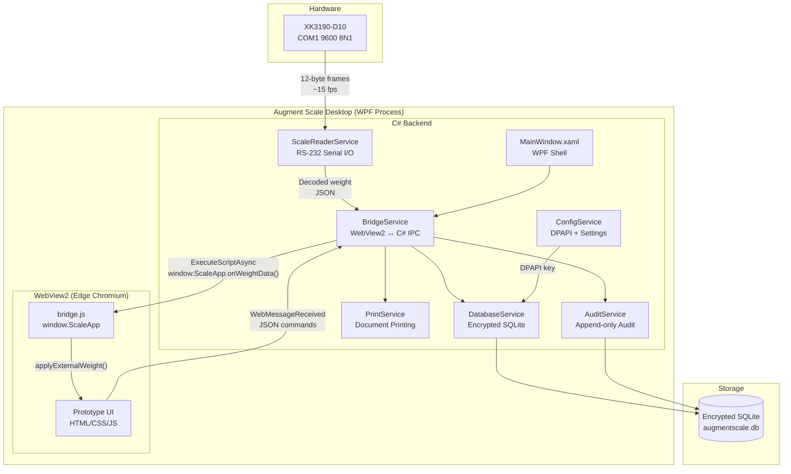

# Augment Scale Desktop — Implementation Plan

## Goal

Build **Augment Scale Desktop** — a C#/.NET 8 WPF + WebView2 hybrid desktop application that:

1. Renders the **validated prototype UI** (`prototype/`) pixel-perfectly inside Microsoft Edge WebView2
2. Provides a C# backend for RS-232 serial I/O (XK3190-D10 indicator), encrypted SQLite persistence, credential protection, and printing
3. Replaces the prototype's in-memory state with durable SQLite storage following the approved [Database_Design.md](file:///Users/shawon/Documents/weight-scale/weight-scale-onsite-testing-report/prototype-to-production/Database_Design.md)
4. Prepares (but does not implement) the Supabase sync outbox for a future phase

The app is built inside `desktop_app/` in the workspace root.

---

## User Review Required

> [!IMPORTANT]
> **Target framework.** This plan targets **.NET 8 (LTS)** with WPF + WebView2. The target machine is Windows 10 Pro 64-bit (Gigabyte H61M-DS2). Confirm .NET 8 is acceptable or if you prefer .NET 9.

**Decision:** .NET 8 is acceptable.

> [!IMPORTANT]
> **SQLite encryption.** The plan uses **Microsoft.Data.Sqlite** with **SQLCipher** (via `SQLitePCLRaw.bundle_e_sqlcipher`). The encryption key is protected by **Windows DPAPI** (per-user, per-machine). Confirm this is the desired approach, or if you prefer a simpler unencrypted SQLite for Phase 1.

**Decision:** SQLCipher + DPAPI is acceptable.

> [!IMPORTANT]
> **Fonts.** The prototype loads IBM Plex Sans + JetBrains Mono from Google Fonts CDN. In the desktop app, these should be bundled locally (no internet dependency for fonts). The plan bundles WOFF2 files inside the WebView2 virtual host.

**Decision:** Fonts should be bundled locally.

> [!IMPORTANT]
> **Printing.** The prototype uses `window.print()` for browser-native print. The plan keeps this approach inside WebView2 (which delegates to the system print dialog). Confirm this is acceptable, or if you want C#-controlled silent printing to a specific printer.

**Decision:** `window.print()` is acceptable. 

---

## Open Questions

> [!IMPORTANT]
> **Q1 — Seed data in production.** The prototype has hardcoded operators, trucks, and 30-day seed history for demo purposes. In production, should the app start with:
> - (a) Empty database + a setup wizard to create the first organization/site/operator, or
> - (b) Pre-seeded with the same demo data for initial testing, with a "reset to production" option?
>
> **My recommendation:** (a) — empty database with a first-run setup flow.

**Decision:** (a) — empty database with a first-run setup flow.

> [!IMPORTANT]
> **Q2 — Operator authentication.** The prototype uses hardcoded PINs (`1234` for all). For Phase 1:
> - (a) Keep PIN-based quick-switch (PINs stored in DPAPI-protected local store), or
> - (b) Simple operator selection without PIN (trusted cabin environment)?
>
> **My recommendation:** (a) — PINs via DPAPI, since the prototype already has the PIN UI.

**Decision:** (a) - PIN-based quick-switch.

> [!IMPORTANT]
> **Q3 — First-run provisioning.** The database design requires `organizations`, `sites`, `weighbridges`, `workstations`, and `profiles` to exist before any ticket can be created. For Phase 1 single-site, should we:
> - (a) Auto-create these on first run from a `setup.json` config file, or
> - (b) Build a first-run wizard UI inside WebView2?
>
> **My recommendation:** (a) — JSON config file for Phase 1 simplicity.

**Decision:** (a) - Auto-create on first run from `setup.json`.

---

## Architecture Overview



---

## Proposed Changes

### Component 1: Solution & Project Structure

#### [NEW] `desktop_app/AugmentScale.sln`

Solution file containing a single WPF project.

#### [NEW] `desktop_app/AugmentScale/AugmentScale.csproj`

```xml
<Project Sdk="Microsoft.NET.Sdk">
  <PropertyGroup>
    <OutputType>WinExe</OutputType>
    <TargetFramework>net8.0-windows</TargetFramework>
    <UseWPF>true</UseWPF>
    <RootNamespace>AugmentScale</RootNamespace>
    <AssemblyName>AugmentScale</AssemblyName>
    <ApplicationIcon>Resources\app-icon.ico</ApplicationIcon>
    <Version>1.0.0</Version>
    <Company>Augment Digital Scale</Company>
    <Product>Augment Scale</Product>
  </PropertyGroup>

  <ItemGroup>
    <!-- WebView2 for rendering the prototype UI -->
    <PackageReference Include="Microsoft.Web.WebView2" Version="1.0.2792.45" />

    <!-- SQLite with SQLCipher encryption -->
    <PackageReference Include="Microsoft.Data.Sqlite" Version="8.0.10" />
    <PackageReference Include="SQLitePCLRaw.bundle_e_sqlcipher" Version="2.1.10" />

    <!-- Serial port (built into .NET, but explicit reference for clarity) -->
    <PackageReference Include="System.IO.Ports" Version="8.0.0" />

    <!-- JSON serialization -->
    <PackageReference Include="System.Text.Json" Version="8.0.5" />
  </ItemGroup>

  <!-- Embed the prototype web assets -->
  <ItemGroup>
    <Content Include="WebUI\**\*" CopyToOutputDirectory="PreserveNewest" />
    <Content Include="Resources\**\*" CopyToOutputDirectory="PreserveNewest" />
  </ItemGroup>
</Project>
```

#### [NEW] `desktop_app/AugmentScale/WebUI/` (copied from `prototype/`)

The entire prototype directory is copied here with the following modifications:
- **`index.html`**: Google Fonts CDN links replaced with local `@font-face` declarations
- **`css/fonts/`**: Bundled WOFF2 files for IBM Plex Sans and JetBrains Mono
- **`js/bridge.js`**: Extended with `postMessage` commands for C# → JS and JS → C# communication
- **`js/scale-simulator.js`**: Auto-start disabled in production mode (only starts when C# signals dev mode)
- **`js/sync.js`**: Sync UI preserved but backed by real outbox status from C# (Phase 2 prep)
- **No other UI files are modified** — the prototype renders pixel-perfectly

---

### Component 2: WPF Shell

#### [NEW] `App.xaml` / `App.xaml.cs`

- Global exception handler
- Single-instance enforcement (Mutex) — only one Augment Scale per machine
- Startup: initialize `ConfigService`, `DatabaseService`

#### [NEW] `MainWindow.xaml` / `MainWindow.xaml.cs`

- Full-screen, borderless WPF window (kiosk-style for cabin PCs)
- Contains a single `WebView2` control filling the entire window
- Keyboard shortcut `Ctrl+Shift+D` to toggle title bar / dev tools
- `F11` to toggle fullscreen / windowed

```xml
<Window x:Class="AugmentScale.MainWindow"
        xmlns="http://schemas.microsoft.com/winfx/2006/xaml/presentation"
        xmlns:wv2="clr-namespace:Microsoft.Web.WebView2.Wpf;assembly=Microsoft.Web.WebView2.Wpf"
        Title="Augment Scale" WindowState="Maximized" WindowStyle="None"
        ResizeMode="NoResize">
  <Grid>
    <wv2:WebView2 x:Name="webView" DefaultBackgroundColor="Transparent" />
  </Grid>
</Window>
```

**Initialization sequence:**
1. `EnsureWebView2Runtime()` — check Edge WebView2 runtime is installed
2. `InitializeAsync()` — create WebView2 environment with user data folder
3. `SetVirtualHostNameToFolderMapping("augmentscale.local", "WebUI/", ...)` — serve prototype files from local folder
4. `Navigate("https://augmentscale.local/index.html")`
5. Wire `WebMessageReceived` event to `BridgeService`
6. Start `ScaleReaderService`

---

### Component 3: WebView2 Bridge (C# ↔ JS IPC)

#### [NEW] `Services/BridgeService.cs`

The central message router between C# and the JS UI. This is the **most critical component** — it replaces the prototype's in-memory state with database-backed operations.

**C# → JS (push):**
```csharp
// Scale weight data (called ~15 times/sec from ScaleReaderService)
await webView.ExecuteScriptAsync(
    $"window.ScaleApp.onWeightData({JsonSerializer.Serialize(weightData)})");

// Toast notifications
await webView.ExecuteScriptAsync(
    $"window.ScaleApp.showToast('{message}', '{type}')");
```

**JS → C# (pull via `postMessage`):**

The existing `bridge.js` exposes `window.ScaleApp` for C# → JS. For JS → C#, we add a new channel: the UI calls `window.chrome.webview.postMessage(JSON)` and C# handles it in `WebMessageReceived`.

Command protocol (JSON envelope):

```json
{
  "command": "createTicket",
  "payload": { "truckNo": "DM-T-11-2045", "direction": "IN", ... },
  "requestId": "uuid-for-response-correlation"
}
```

**Command inventory (replacing prototype's in-memory mutations):**

| JS Command | C# Handler | Description |
|---|---|---|
| `getOperators` | → `DatabaseService.GetProfiles()` | Load operator list for login screen |
| `authenticatePin` | → `ConfigService.ValidatePin()` | PIN verification via DPAPI-stored hashes |
| `getPendingTickets` | → `DatabaseService.GetPendingTickets()` | Load pending tickets for dashboard |
| `createTicket` | → `DatabaseService.CreateTicket()` | First weigh commit → `weigh_tickets` + `weight_captures` + `print_jobs` |
| `completeTicket` | → `DatabaseService.CompleteTicket()` | Second weigh commit → update ticket + new capture + print job |
| `deleteTicket` | → `DatabaseService.SoftDeleteTicket()` | Soft delete pending ticket |
| `voidTicket` | → `DatabaseService.VoidTicket()` | Void completed ticket + correction record |
| `getHistory` | → `DatabaseService.QueryTicketHistory()` | Paginated, filtered history from `ticket_history` view |
| `getVehicles` | → `DatabaseService.GetVehicles()` | Truck list with cached stats |
| `registerVehicle` | → `DatabaseService.UpsertVehicle()` | Create or update vehicle |
| `archiveVehicle` | → `DatabaseService.ArchiveVehicle()` | Soft-delete vehicle (with open-ticket guard) |
| `restoreVehicle` | → `DatabaseService.RestoreVehicle()` | Restore archived vehicle |
| `recordPrint` | → `DatabaseService.RecordPrintJob()` | Log print/reprint |
| `recordReprint` | → `DatabaseService.RecordReprint()` | Reprint with reason + copy number |
| `getNextTicketNumber` | → `DatabaseService.PeekNextTicketNumber()` | Sequential ticket number |
| `getSyncStatus` | → Returns outbox queue depth | Phase 2 prep |

**Response protocol:**
```json
{
  "requestId": "uuid",
  "success": true,
  "data": { ... }
}
```

#### [MODIFY] `WebUI/js/bridge.js`

Extended with JS → C# messaging:

```javascript
// New: JS → C# command channel
ScaleApp.sendCommand = async (command, payload = {}) => {
  const requestId = crypto.randomUUID();
  return new Promise((resolve, reject) => {
    const timeout = setTimeout(() => {
      delete ScaleApp._pendingRequests[requestId];
      reject(new Error(`Command '${command}' timed out`));
    }, 10000);

    ScaleApp._pendingRequests[requestId] = { resolve, reject, timeout };

    window.chrome.webview.postMessage(JSON.stringify({
      command, payload, requestId
    }));
  });
};

ScaleApp._pendingRequests = {};

// C# calls this to deliver command responses
ScaleApp.onCommandResponse = (response) => {
  const pending = ScaleApp._pendingRequests[response.requestId];
  if (pending) {
    clearTimeout(pending.timeout);
    delete ScaleApp._pendingRequests[response.requestId];
    if (response.success) {
      pending.resolve(response.data);
    } else {
      pending.reject(new Error(response.error || 'Command failed'));
    }
  }
};
```

---

### Component 4: Serial Scale Reader

#### [NEW] `Services/ScaleReaderService.cs`

Direct C# port of the verified Python implementation in [xk3190_console_test.py](file:///Users/shawon/Documents/weight-scale/weight-scale-onsite-testing-report/prototype-to-production/XK3190_Scale_Reader/xk3190_console_test.py).

**Key design:**
- Runs on a dedicated background thread (not Task/async, since `SerialPort.Read` is blocking)
- Exact same frame protocol: STX (0x02) + sign + 6 digits + decimal(0-4) + 2 XOR checksum chars + ETX (0x03)
- Same `SplitFrames()` logic: handles mid-frame starts, stray ETX, partial tails, 1KB garbage guard
- Same `DecodeFrame()` logic: validates checksum via XOR of bytes 2–9
- Produces `WeightReading` events at ~15 Hz → `BridgeService` pushes to WebView2
- Stability detection: configurable window (default 500ms), variance threshold from `scale_connection_profiles`
- Health events: `connected`, `disconnected`, `checksum_error`, `no_data_timeout`, `port_in_use` → logged to `scale_health_events`
- Graceful port-contention handling: if COM port is held by another process, show clear error in UI (matching Python behavior)

```csharp
public class WeightReading
{
    public double WeightKg { get; set; }
    public string RawDigits { get; set; }       // "018420"
    public string Sign { get; set; }             // "+" or "-"
    public int DecimalCount { get; set; }        // 0-4
    public bool ChecksumValid { get; set; }
    public string ChecksumExpected { get; set; } // "1A"
    public string ChecksumActual { get; set; }   // "1A"
    public string RawFrameHex { get; set; }      // Full 12 bytes
    public bool IsStable { get; set; }
    public double StabilityVariance { get; set; }
    public int StabilitySampleCount { get; set; }
    public string Source { get; set; }           // "hardware" or "simulator"
    public DateTime CapturedAt { get; set; }
}
```

**Stability algorithm:**
```csharp
// Rolling window of recent readings (configurable, default 500ms ≈ 7-8 frames)
// Stable when: max(window) - min(window) <= stabilityToleranceKg
private readonly CircularBuffer<double> _stabilityWindow = new(16);

private bool EvaluateStability(double weightKg)
{
    _stabilityWindow.Add(weightKg);
    if (_stabilityWindow.Count < 3) return false;
    var variance = _stabilityWindow.Max() - _stabilityWindow.Min();
    return variance <= _config.StabilityToleranceKg;
}
```

---

### Component 5: Database Service

#### [NEW] `Services/DatabaseService.cs`

Encrypted SQLite with full schema from [Database_Design.md](file:///Users/shawon/Documents/weight-scale/weight-scale-onsite-testing-report/prototype-to-production/Database_Design.md).

**Initialization:**
1. Read encryption key from DPAPI-protected store (`ConfigService`)
2. Open/create `augmentscale.db` with SQLCipher: `PRAGMA key = '...'`
3. Run schema migration (version-tracked in a `schema_version` table)
4. Create the `ticket_history` view
5. Build all indexes

**Key operations (all within explicit transactions + audit events):**

##### `CreateTicket()` — First Weigh Commit

```csharp
public async Task<WeighTicket> CreateTicket(CreateTicketRequest req)
{
    using var txn = _connection.BeginTransaction();

    // 1. Generate UUID for ticket
    var ticketId = Guid.NewGuid().ToString();

    // 2. Allocate sequential ticket number (org+site scoped)
    var ticketNumber = GetNextTicketNumber(req.OrganizationId, req.SiteId);

    // 3. Create weight_capture record (metrological evidence)
    var captureId = Guid.NewGuid().ToString();
    InsertWeightCapture(captureId, ticketId, req.WeightReading, ...);

    // 4. Create weigh_ticket record
    InsertWeighTicket(ticketId, ticketNumber, req, captureId, ...);

    // 5. Upsert vehicle (register if new plate, update defaults if existing)
    UpsertVehicle(req.PlateNumber, req.Driver, req.Material, req.Client, ...);

    // 6. Create print_job record (first_weigh_slip, copy_number=1)
    InsertPrintJob(ticketId, "first_weigh_slip", 1, false, ...);

    // 7. Create audit_event
    InsertAuditEvent("weigh_tickets", ticketId, "insert", ...);

    txn.Commit();
    return ticket;
}
```

##### `CompleteTicket()` — Second Weigh Commit

```csharp
public async Task<WeighTicket> CompleteTicket(CompleteTicketRequest req)
{
    using var txn = _connection.BeginTransaction();

    // 1. Create second weight_capture
    // 2. Update weigh_ticket: second weight fields, gross/tare/net, status='completed'
    // 3. Create print_job (weighbridge_certificate, copy_number=1)
    // 4. Update vehicle stats (trip_count++, last_weighed_at, last_tare_kg)
    // 5. Create audit_event (action='complete')
    // 6. Insert outbox_event (for future sync)

    txn.Commit();
    return ticket;
}
```

##### `VoidTicket()` — Atomic Void

```csharp
public async Task VoidTicket(string ticketId, string reason, string operatorId)
{
    using var txn = _connection.BeginTransaction();

    // 1. Update weigh_ticket: status='voided', voided_at, voided_by, voided_reason
    // 2. Insert ticket_correction (correction_type='void')
    // 3. Rollback vehicle stats (trip_count--, recompute last_weighed_at/last_tare_kg)
    // 4. Insert audit_event (action='void')
    // 5. Insert outbox_event

    txn.Commit();
}
```

#### [NEW] `Data/Schema/V001_InitialSchema.sql`

The complete DDL from Database_Design.md (§Table Definitions + §Indexes), in a migration file. Only includes **local SQLite tables** (excludes cloud-only: `sync_changes`, `device_events`). Includes local-only: `outbox_events`, `sync_cursors`, `offline_leases`.

#### [NEW] `Data/Schema/migrations.sql`

```sql
CREATE TABLE IF NOT EXISTS schema_version (
    version INTEGER PRIMARY KEY,
    name TEXT NOT NULL,
    applied_at TEXT NOT NULL DEFAULT (datetime('now'))
);
```

---

### Component 6: Configuration & Security

#### [NEW] `Services/ConfigService.cs`

- **DPAPI-protected storage** for:
  - SQLite encryption key (auto-generated on first run, 256-bit random)
  - Operator PIN hashes (bcrypt or PBKDF2)
  - Future: Supabase credentials
- **`setup.json`** for first-run provisioning:

```json
{
  "organization": {
    "name": "Meghna Ship Recycling",
    "address": "Bhatiari, Sitakunda, Chattogram"
  },
  "site": {
    "name": "Main Yard",
    "timezone": "Asia/Dhaka"
  },
  "weighbridge": {
    "name": "Weighbridge 1",
    "maxCapacityKg": 60000,
    "minDivisionKg": 5
  },
  "scaleConnection": {
    "portName": "COM1",
    "baudRate": 9600,
    "dataBits": 8,
    "parity": "None",
    "stopBits": 1,
    "protocolFormat": "yaohua_format_1",
    "stabilityWindowMs": 500,
    "stabilityToleranceKg": 10
  },
  "operators": [
    {
      "displayName": "MD. RAJU",
      "initials": "MR",
      "role": "supervisor",
      "shift": "Shift A",
      "color": "#4C7875",
      "pin": "1234"
    }
  ]
}
```

---

### Component 7: Audit Service

#### [NEW] `Services/AuditService.cs`

- Thin wrapper that produces `audit_events` rows within the caller's transaction
- Maps prototype `logAction()` calls to the audit schema (see mapping table in Database_Design.md §17)
- Never UPDATEs or DELETEs audit rows
- Phase 2: hash chain (`previous_event_hash`, `event_hash`)

---

### Component 8: Print Service

#### [NEW] `Services/PrintService.cs`

- Delegates to WebView2's built-in `window.print()` (the prototype already formats the slip/certificate)
- Records every print/reprint in `print_jobs` table
- Phase 2: Silent printing to a named printer via `CoreWebView2.PrintAsync()`

---

### Component 9: JS State Adapter Layer

This is the **key integration challenge**: the prototype's JS reads/writes in-memory arrays (`pendingTickets`, `completedTickets`, `REGISTERED_TRUCKS`, etc.). In production, these must be replaced with async calls to the C# backend.

#### [MODIFY] `WebUI/js/state.js`

The adapter strategy:

```javascript
// Production mode: state operations delegate to C# backend
const IS_PRODUCTION = !!window.chrome?.webview;

// Replace direct array mutations with async backend calls
export async function loadPendingTickets() {
  if (IS_PRODUCTION) {
    const tickets = await ScaleApp.sendCommand('getPendingTickets');
    pendingTickets.length = 0;
    pendingTickets.push(...tickets);
  }
  return pendingTickets;
}

export async function commitFirstWeigh(ticketData) {
  if (IS_PRODUCTION) {
    const ticket = await ScaleApp.sendCommand('createTicket', ticketData);
    pendingTickets.unshift(ticket);
    return ticket;
  }
  // Fallback: prototype in-memory behavior (for browser dev/demo)
  // ... existing code unchanged ...
}
```

**Critical principle:** The prototype JS code is **not rewritten**. Instead, a thin adapter layer intercepts mutation points and delegates to C# when `IS_PRODUCTION` is true. In browser mode (no WebView2), the existing in-memory behavior remains for development and demos.

---

## Project File Structure

```
desktop_app/
├── AugmentScale.sln
├── AugmentScale/
│   ├── AugmentScale.csproj
│   ├── App.xaml
│   ├── App.xaml.cs
│   ├── MainWindow.xaml
│   ├── MainWindow.xaml.cs
│   ├── Services/
│   │   ├── BridgeService.cs          # WebView2 ↔ C# message router
│   │   ├── ScaleReaderService.cs     # RS-232 serial reader (port from Python)
│   │   ├── DatabaseService.cs        # Encrypted SQLite CRUD
│   │   ├── ConfigService.cs          # DPAPI key management + setup.json
│   │   ├── AuditService.cs           # Append-only audit_events
│   │   └── PrintService.cs           # Print job tracking
│   ├── Models/
│   │   ├── WeighTicket.cs
│   │   ├── WeightCapture.cs
│   │   ├── WeightReading.cs
│   │   ├── Vehicle.cs
│   │   ├── Profile.cs
│   │   ├── PrintJob.cs
│   │   ├── AuditEvent.cs
│   │   ├── ScaleHealthEvent.cs
│   │   ├── OutboxEvent.cs
│   │   └── Commands/                 # Request/response DTOs
│   │       ├── CreateTicketRequest.cs
│   │       ├── CompleteTicketRequest.cs
│   │       └── ...
│   ├── Data/
│   │   ├── Schema/
│   │   │   ├── migrations.sql        # Schema version tracking
│   │   │   └── V001_InitialSchema.sql # Full DDL from Database_Design.md
│   │   └── Migrations/
│   │       └── MigrationRunner.cs    # Applies schema versions in order
│   ├── Protocol/
│   │   ├── Xk3190FrameDecoder.cs     # Frame decode + XOR checksum
│   │   ├── Xk3190FrameSplitter.cs    # Buffer → complete frames
│   │   └── StabilityDetector.cs      # Rolling-window stability
│   ├── WebUI/                        # ← Prototype files (mostly untouched)
│   │   ├── index.html                # Modified: local fonts
│   │   ├── css/
│   │   │   ├── fonts/                # NEW: bundled WOFF2 fonts
│   │   │   ├── tokens.css
│   │   │   ├── base.css
│   │   │   └── ... (all existing CSS)
│   │   ├── js/
│   │   │   ├── bridge.js             # Modified: + sendCommand + IS_PRODUCTION
│   │   │   ├── state.js              # Modified: + async backend delegates
│   │   │   ├── main.js               # Modified: + production bootstrap
│   │   │   └── ... (all existing JS, unmodified)
│   │   ├── partials/                 # All existing partials, unmodified
│   │   └── avatars/                  # All existing SVG avatars
│   └── Resources/
│       ├── app-icon.ico
│       └── setup.json                # First-run provisioning config
└── AugmentScale.Tests/
    ├── AugmentScale.Tests.csproj
    ├── Protocol/
    │   ├── Xk3190FrameDecoderTests.cs # Port of Python unit tests
    │   ├── Xk3190FrameSplitterTests.cs
    │   └── StabilityDetectorTests.cs
    ├── Services/
    │   ├── DatabaseServiceTests.cs
    │   └── AuditServiceTests.cs
    └── Data/
        └── SchemaTests.cs             # DDL creates without error
```

---

## Implementation Phases (Execution Order)

### Phase A: Scaffold & Build (Day 1)

1. Create solution + project structure
2. Copy prototype `WebUI/` files
3. Bundle fonts locally (replace CDN links)
4. Implement `MainWindow.xaml` with WebView2
5. **Verify:** Prototype UI renders pixel-perfectly in WebView2

### Phase B: Serial Reader (Day 1-2)

1. Port `Xk3190FrameDecoder` from Python
2. Port `Xk3190FrameSplitter` from Python
3. Implement `StabilityDetector`
4. Implement `ScaleReaderService` with background thread
5. Wire to WebView2 via `window.ScaleApp.onWeightData()`
6. **Verify:** Unit tests pass (port Python test cases); live weight display works in simulator mode

### Phase C: Database (Day 2-3)

1. Implement `ConfigService` (DPAPI key management)
2. Implement schema migration runner
3. Write `V001_InitialSchema.sql` from Database_Design.md
4. Implement `DatabaseService` core operations
5. Implement `AuditService`
6. **Verify:** Schema creates without error; round-trip insert/read tests pass

### Phase D: Bridge Integration (Day 3-4)

1. Extend `bridge.js` with `sendCommand()` and `IS_PRODUCTION` mode
2. Implement `BridgeService` command router
3. Adapt `state.js` mutation points with production delegates
4. Wire `createTicket`, `completeTicket`, `getPendingTickets`, `getHistory`
5. Wire `getVehicles`, `registerVehicle`, `archiveVehicle`, `restoreVehicle`
6. Wire `voidTicket`, `deleteTicket`, `recordReprint`
7. **Verify:** Full weighing cycle works: login → first weigh → dashboard → second weigh → certificate → history

### Phase E: Polish & Harden (Day 4-5)

1. Single-instance enforcement (Mutex)
2. Port-contention handling + user-friendly error messages
3. Print job recording
4. Scale health event logging
5. Global exception handling + error logging
6. First-run setup from `setup.json`
7. **Verify:** End-to-end smoke test; error scenarios tested

---

## Key Design Decisions

### 1. Minimal JS Changes

The prototype JS is **not refactored or rewritten**. Only three files are modified:
- `bridge.js` — add `sendCommand()` channel
- `state.js` — add production-mode delegates at mutation points
- `main.js` — add production bootstrap (load initial data from C# before screen init)

All other 20+ JS files, all CSS, all HTML partials, and all SVG assets are **copied verbatim**. This ensures pixel-perfect UI fidelity.

### 2. Serial Protocol as Dedicated C# Classes

The XK3190 frame decoder and splitter are isolated in `Protocol/` namespace with their own unit tests, directly ported from the verified Python implementation. This makes them testable without hardware and reusable for future indicator models.

### 3. Transaction + Audit Atomicity

Every business mutation (create ticket, complete, void, delete, archive, restore) is wrapped in a single SQLite transaction that also inserts the corresponding `audit_events` row. This matches the database design's "same transaction" requirement.

### 4. Outbox-Ready Architecture

`outbox_events` rows are inserted during business transactions but never consumed in Phase 1. The sync worker (Phase 2) will read them. This means no data is lost during the offline period between Phase 1 and Phase 2.

---

## Verification Plan

### Automated Tests

```bash
# Run all unit tests
cd desktop_app
dotnet test AugmentScale.Tests/

# Specific test suites:
dotnet test --filter "FullyQualifiedName~Xk3190FrameDecoder"   # Protocol decoder
dotnet test --filter "FullyQualifiedName~Xk3190FrameSplitter"  # Frame splitting
dotnet test --filter "FullyQualifiedName~StabilityDetector"     # Stability window
dotnet test --filter "FullyQualifiedName~DatabaseService"       # CRUD operations
dotnet test --filter "FullyQualifiedName~SchemaTests"           # DDL validation
```

**Test cases ported from Python:**
- Real frame decode: weight 0 (`02 2B 30 30 30 30 30 30 30 31 42 03`) → 0.0
- Real frame decode: weight 735 (`02 2B 30 30 30 37 33 35 30 31 41 03`) → 735.0
- Fabricated frame: weight 123.4 with 1 decimal → 123.4
- Tampered frame: corrupted checksum → `ChecksumValid = false`
- Negative frame: -50.0 with 2 decimals
- Frame splitter: mid-frame buffer start
- Frame splitter: stray ETX handling
- Frame splitter: 1KB garbage guard

**Database tests:**
- Schema creation: all tables, indexes, views created without error
- Ticket lifecycle: create → complete → void → history query
- Vehicle lifecycle: register → archive guard (open ticket) → archive → restore
- Print tracking: first print → reprint with reason → copy number uniqueness
- Audit immutability: every mutation produces an audit row

### Manual Verification

1. **UI fidelity**: Compare the WebView2-rendered app side-by-side with the prototype in a browser — every screen, every animation, every state should be identical
2. **Serial reader**: Connect to the XK3190 scale on COM1 — live weight display updates at ~15 fps with correct values matching the indicator display
3. **Port contention**: Start `Scale Weight.exe` first, then start Augment Scale — should show a clear error message, not crash
4. **Full weighing cycle**: Login → select IN WEIGHT → enter truck details → capture weight → print first-weigh slip → dashboard shows pending ticket → select ticket → capture second weight → print certificate → verify in History
5. **Data persistence**: Complete a weighing cycle, close the app, reopen — all data is preserved
6. **Void + reprint**: Void a completed ticket with a reason → verify it appears as voided in History → reprint with a reason → verify copy number increments
7. **Truck management**: Register new truck → archive with reason → verify blocked while pending ticket exists → complete ticket → archive succeeds → restore → verify single identity


**Decision:** After finishing building write a complete user manual in markdown format like how to run the app, how to compile and how to build from scratch. Manually and how to manually run the application and all other secrets and testing guideline. In summary, I want a complete user manual.

