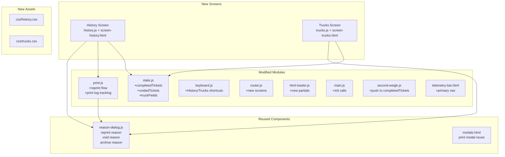

# History, Trucks & Reprint — Implementation Plan

## Goal

Add three capabilities to the weighbridge desktop prototype, all reading/writing the same in-memory data the dashboard and weigh screens already use:

1. **History page** — paginated table of completed + voided + deleted-pending tickets, date-filtered, with detail panel and operator avatars.
2. **Trucks page** — CRUD list for the vehicle master, sharing the first-weigh register form, with archive instead of hard delete.
3. **Reprint** — replay the stored certificate exactly, stamp "Reprint" on the paper, log every print with reason, show print count on the row.

Supporting changes: ticket voiding (with struck-through display), completed-ticket deletion lockout, print-job tracking in state, and a permission/action-logging skeleton.

---

## Final Decisions (as built)

The questions above were resolved during implementation; this section is the source of truth.

- **Navigation lives in the persistent telemetry bar**, not a footer tab strip. It costs zero extra vertical space, is defined once in `partials/telemetry-bar.html`, and is hidden on login and both weigh screens. Every route goes through `requestNavigation()`, which refuses to leave a half-finished weigh.
- **Semantics:** `<nav aria-label="Primary">` with `<button aria-current="page">` (routing, not an in-page tablist).
- **Chords:** `Alt+D` Dashboard, `Alt+H` History, `Alt+T` Trucks (`NAV_MODIFIER = 'alt'`; flip to `'ctrl'` in the WebView2 host where browser accelerators are disabled). In-screen: `Alt+R` reprint, `Alt+V` void, `Alt+N` new vehicle; `Enter` opens the detail/edit view, `Backspace` archives a truck, `/` or type-to-search focuses search, `Esc` backs out one layer.
- **History source is the full ledger:** `getAllTickets()` merges pending + completed + voided + deleted, newest first.
- **Stage is derived, not stored:** `first` = no second weight (pending or deleted while waiting), `complete` = second weight/net exists. Chips are `All stages | First only | Complete` and AND-combine with the status filter (`All | Pending | Completed | Voided | Deleted`).
- **Seed:** 30 days, 203 tickets total — 190 completed, 6 voided, 4 deleted-pending, plus the 3 live pending tickets. Seeded with `mulberry32(20261020)` and IDs below 11353, so `peekNextTicketId()` still starts at 11353. ~20 completed land on today, ~14 yesterday, the rest spread across the window so every date filter has data.
- **Table has 7 columns** (Ticket, Truck, Gross, Tare, Net, Status, Prints). The original 9-column layout cannot fit beside a 30% detail panel at 1024px; material/client/driver live in the detail panel and search.
- **Q2 resolved:** the pager reads `1–20 of 194`; `of N` is the filtered count and the page size is measured from the live row height (fallback 56px), recalculated on `screenchange` and resize.
- **Q3 resolved:** the More popover uses multi-select checkboxes for operators/materials/clients, with Apply, Clear all, and an active-count badge. Filters rebuild from applied state each time it opens.
- **Footer stats:** ticket count is the filtered row count; tonnage sums `netWeight` for completed rows only (voided/pending excluded).
- **Reprint:** pending → first-weigh slip, completed/voided → certificate, deleted → audit-only (blocked). Each reprint requires a reason, increments `printCount`, appends to `printLog`, stamps `DUPLICATE COPY`, and refreshes History. Printing stays on the current screen.
- **Void:** only completed tickets; reason required; the ticket moves to `voidedTickets`, renders struck through, and is logged in `actionLog`.
- **Trucks:** archive instead of delete, with reason and audit fields; archiving is blocked while the plate has an open pending ticket. Archived vehicles are hidden from first-weigh autocomplete and shown only when "Show archived" is on. Restore requires confirmation.

### File inventory

- New: `js/seed-data.js`, `js/screens/history.js`, `js/screens/trucks.js`, `css/history.css`, `css/trucks.css`, `partials/screen-history.html`, `partials/screen-trucks.html`.
- Modified: `js/state.js`, `js/router.js`, `js/keyboard.js`, `js/print.js`, `js/html-loader.js`, `js/main.js`, `partials/telemetry-bar.html`, `partials/modals.html`, `css/layout.css`, `index.html`, `tests/self_check.js`.

---

## User Review Required (historical proposal — superseded by Final Decisions above)

> [!IMPORTANT]
> **Tab navigation between History / Trucks / Dashboard.** The current app has no tab bar — the dashboard is the only "home" screen. This plan adds a lightweight nav strip to the dashboard footer area with three tabs: **Dashboard**, **History**, **Trucks**. Keyboard: `1` = Dashboard, `3` = History, `4` = Trucks (reserving `2` for Second Weigh which is contextual). Is this navigation model acceptable, or do you prefer different keys / a sidebar?

> [!IMPORTANT]
> **Completed ticket store.** The prototype currently has no `completedTickets` array — tickets leave `pendingTickets` on second-weigh commit and vanish. To power the History page, this plan adds a `completedTickets` array and a `voidedTickets` array in `state.js`, populated by the second-weigh commit flow and a new void action. The existing `deletedTickets` array (deleted pending tickets) is already tracked. All three arrays feed the History page with demo seed data. Acceptable?

> [!WARNING]
> **No real persistence yet.** Everything is still in-memory. The arrays will have demo seed data so the History and Trucks pages are functional on first load, matching the prototype's approach to `pendingTickets` and `REGISTERED_TRUCKS`.

---

## Open Questions (resolved — kept for history)

> [!IMPORTANT]
> **Q1 — Tab key assignments.** Resolved: `Alt+D` / `Alt+H` / `Alt+T` via the telemetry-bar nav (see Final Decisions).

> [!IMPORTANT]
> **Q2 — History page row count auto-fit.** You said "row count fitted to screen height". I'll calculate visible rows as `Math.floor((availableHeight - headerFooterHeight) / rowHeight)` on mount and on resize. The no-scroll constraint means the table body has `overflow: hidden` and PageUp/PageDown flip pages. Should the page indicator show `Page 1 of N` or `1–20 of 142`? I'll default to the range style (`1–20 of 142`).

> [!IMPORTANT]
> **Q3 — "More" popover filters.** For operator, material, and client filters behind a "More" button — should these be multi-select checkboxes, or single-select dropdowns? Multi-select is more useful for filtering ("show tickets from operator A or B") but heavier. I'll default to multi-select checkboxes with an "Apply" button.

---

## Architecture Overview



---

## Proposed Changes

### State Layer (`state.js`)

#### [MODIFY] `state.js`

Add completed/voided ticket tracking, truck enhancements, and print log tracking.

```diff
+// Completed tickets (second weigh done, certificate printed)
+export let completedTickets = [
+  // Demo seed data — 8-10 completed tickets across today and yesterday
+  {
+    id: 11348, truckNo: 'DM-T-11-2045', driver: 'Kalam Hossain',
+    phone: '+880 1711 002233', material: 'Scrap Iron', client: 'BSRM Steels Ltd',
+    weightType: 'IN WEIGHT', direction: 'IN',
+    firstWeight: 38200, firstWeightType: 'Gross',
+    firstWeightTime: '20-10-26 07:22:00 AM', firstOperator: 'MD. RAJU',
+    firstOperatorId: 'mr', firstOperatorAvatar: 'avatars/frame-9.svg',
+    secondWeight: 14500, secondWeightType: 'Tare',
+    secondWeightTime: '20-10-26 09:45:00 AM', secondOperator: 'AKHTER K.',
+    secondOperatorId: 'ak', secondOperatorAvatar: 'avatars/frame-4.svg',
+    grossWeight: 38200, tareWeight: 14500, netWeight: 23700,
+    challan: 'CH-44021', remarks: '',
+    completedAt: '2026-10-20T09:45:00+06:00',
+    status: 'completed', printCount: 1,
+    printLog: [{ by: 'MD. RAJU', at: '2026-10-20T09:45:12+06:00', type: 'weighbridge_certificate', reason: null }],
+  },
+  // ... more seed entries for today + yesterday + 7 days
+];
+
+export function setCompletedTickets(tickets) { completedTickets = tickets; }
+
+// Voided tickets (weight error → void with reason → re-weigh)
+export let voidedTickets = [
+  {
+    id: 11345, truckNo: 'CTG-TA-12-8844', /* ... full ticket shape ... */
+    status: 'voided', voidedAt: '2026-10-20T08:10:00+06:00',
+    voidedBy: 'MD. RAJU', voidedReason: 'Incorrect truck identified on scale',
+    printCount: 1, printLog: [/*...*/],
+  },
+];
+
+export function setVoidedTickets(tickets) { voidedTickets = tickets; }
```

Enhance `REGISTERED_TRUCKS` entries with the new columns:

```diff
 export let REGISTERED_TRUCKS = [
   {
     plate: 'DM-T-11-2045',
     driver: 'Kalam Hossain',
     phone: '+880 1711 002233',
     material: 'Scrap Iron',
     client: 'BSRM Steels Ltd',
+    lastWeighed: '2026-10-20T09:45:00+06:00',
+    tripCount: 47,
+    lastTare: 14500,
+    status: 'active',  // 'active' | 'archived'
+    archivedAt: null,
+    archivedBy: null,
+    archivedReason: null,
   },
   // ... same for other trucks
 ];
```

Add state properties for History and Trucks screens:

```diff
 export const state = {
   // ... existing ...
+
+  // History screen state
+  history: {
+    currentPage: 0,
+    pageSize: 20,       // recalculated on mount/resize
+    dateFilter: 'today', // 'today' | 'yesterday' | '7days' | 'custom'
+    customDateFrom: null,
+    customDateTo: null,
+    statusFilter: 'all', // 'all' | 'completed' | 'voided' | 'deleted'
+    searchQuery: '',
+    moreFilters: { operators: [], materials: [], clients: [] },
+    selectedTicketId: null,  // for detail panel
+    focusedRowIndex: 0,
+  },
+
+  // Trucks screen state
+  trucks: {
+    searchQuery: '',
+    focusedRowIndex: 0,
+    editingTruck: null,
+  },
 };
```

---

### History Screen

#### [NEW] `partials/screen-history.html`

Full-height screen with no scrolling. Layout:

```
┌──────────────────────────────────────────────────────────────┐
│ Filter Bar: [Search] [Today|Yesterday|7d|Custom] [Status▾] [More▾] │
├──────────────────────────────────────┬───────────────────────┤
│ Paginated Table (~70% width)         │ Detail Panel (~30%)   │
│                                      │                       │
│ ID | Plate | Dir | Gross | Tare | Net│ Selected ticket's     │
│    |       |     |  🧑‍💼   |  🧑‍💼  |    │ full story:           │
│    |       |     | time  | time |    │ - both operators      │
│ ───────────────────────────────────  │ - timestamps          │
│ (rows auto-fitted to screen height)  │ - override details    │
│                                      │ - void/delete reason  │
│                                      │ - print history       │
│                                      │ - sync state          │
├──────────────────────────────────────┴───────────────────────┤
│ Footer: [◀ PgUp] Page 1-20 of 142 [PgDn ▶] │ 42 tickets │ 842.6 MT net │
└──────────────────────────────────────────────────────────────┘
```

**Table columns:**

| Column    | Content                                                                        |
| --------- | ------------------------------------------------------------------------------ |
| Ticket ID | `#I-11348` with direction badge                                                |
| Truck     | Plate tag                                                                      |
| Material  | Text, truncated                                                                |
| Client    | Text, truncated                                                                |
| Gross     | Weight value + small operator avatar below + time                              |
| Tare      | Weight value + small operator avatar below + time                              |
| Net       | Bold weight value                                                              |
| Status    | Chip: `✓ Completed`, `⊘ Voided` (struck through row), `✕ Deleted` (greyed out) |
| Prints    | 🖨 count badge (highlighted if >1)                                              |

**Operator avatars under weights:** Each weight cell has a sub-row with a 20px circular avatar and the time, e.g.:

```html
<td class="hist-weight-cell">
  <span class="hist-weight-val">38,200</span>
  <div class="hist-weight-meta">
    
    <span class="hist-op-time">07:22 AM</span>
  </div>
</td>
```

**Detail Panel** (right side, shows when a row is selected with Enter):

- Header: Ticket `#I-11348` status chip
- Both operators: avatar + name + role + timestamp for each weigh
- Override section (if overridden): reason, authorizing operator, timestamp, anomaly details
- Void section (if voided): reason, voided by, timestamp
- Delete section (if deleted pending): reason, deleted by, timestamp
- Print history: table of all prints (type, by, when, reason if reprint)
- Sync state: icon + last sync time
- Action buttons: `[P] Reprint` (always), `[V] Void` (completed only, supervisor)

**Voided rows:** Full row styled with `text-decoration: line-through`, muted color.
**Deleted pending rows:** Full row greyed out (`opacity: 0.5`), italic.

**Keyboard:**

| Key                 | Action                                                   |
| ------------------- | -------------------------------------------------------- |
| `↑`/`↓`             | Navigate rows                                            |
| `PageUp`/`PageDown` | Flip page                                                |
| `Enter`             | Open/close detail panel for focused row                  |
| `P`                 | Reprint focused ticket                                   |
| `Escape`            | Close detail panel → clear search → go back to dashboard |
| `F`                 | Focus search                                             |
| Type-to-search      | Same as dashboard                                        |
| `V`                 | Void selected completed ticket (opens reason dialog)     |

#### [NEW] `js/screens/history.js`

Key implementation details:

```javascript
// Page size auto-calculation
function calculatePageSize() {
  const container = document.getElementById('history-table-container');
  const rowHeight = 52; // px, matches CSS
  const available = container.clientHeight;
  return Math.max(5, Math.floor(available / rowHeight));
}

// Merged ticket source (all three arrays, sorted by date descending)
function getAllTickets() {
  const all = [
    ...completedTickets.map((t) => ({ ...t, _source: 'completed' })),
    ...voidedTickets.map((t) => ({ ...t, _source: 'voided' })),
    ...deletedTickets.map((t) => ({ ...t, _source: 'deleted' })),
  ];
  return all.sort((a, b) => {
    const dateA = new Date(a.completedAt || a.voidedAt || a.deletedAt || a.firstWeightTime);
    const dateB = new Date(b.completedAt || b.voidedAt || b.deletedAt || b.firstWeightTime);
    return dateB - dateA;
  });
}

// Date filtering
function filterByDate(tickets, filter) {
  const now = new Date();
  const startOfToday = new Date(now.getFullYear(), now.getMonth(), now.getDate());
  switch (filter) {
    case 'today':
      return tickets.filter((t) => getTicketDate(t) >= startOfToday);
    case 'yesterday': /* ... */
    case '7days': /* ... */
    case 'custom': /* ... */
    default:
      return tickets;
  }
}
```

#### [NEW] `css/history.css`

Styles for:

- `.history-screen` — full-height flex layout
- `.hist-filter-bar` — compact horizontal bar with search, date chips, status dropdown, more popover
- `.hist-table-container` — flex-grow, overflow hidden (no scroll)
- `.hist-table` — fixed layout table with known column widths
- `.hist-weight-cell` — stacked weight value + operator avatar + time
- `.hist-op-avatar` — 20px round avatar
- `.hist-detail-panel` — right panel, 30% width, scrollable internally
- `.hist-row--voided` — line-through styling
- `.hist-row--deleted` — greyed out styling
- `.hist-footer` — page navigation + summary stats
- `.hist-print-badge` — print count indicator (amber if >1)

---

### Trucks Screen

#### [NEW] `partials/screen-trucks.html`

```
┌──────────────────────────────────────────────────────────────┐
│ Header: Registered Vehicles  [Search] [N] New  [count badge]│
├──────────────────────────────────────────────────────────────┤
│ Table (full height, no scroll — same pagination as History) │
│ Plate | Default Driver | Mobile | Client | Last Weighed |   │
│       |                |        |        | Trip Count   |   │
│       |                |        |        | Last Tare    |   │
│       |                |        |        | Status       |   │
├──────────────────────────────────────────────────────────────┤
│ Footer: Page info │ Total vehicles: 5                       │
└──────────────────────────────────────────────────────────────┘
```

**Keyboard:**

| Key         | Action                                    |
| ----------- | ----------------------------------------- |
| `N`         | Add new vehicle (opens form dialog)       |
| `Enter`     | Edit selected vehicle (opens form dialog) |
| `Backspace` | Archive selected vehicle (reason dialog)  |
| `↑`/`↓`     | Navigate rows                             |
| `F`         | Focus search                              |
| `Escape`    | Close form → clear search → go back       |

#### [NEW] `js/screens/trucks.js`

The add/edit form dialog **reuses the same fields** as the first-weigh register strip ([`fw-register-strip`](file:///Users/shawon/Documents/weight-scale/weight-scale-onsite-testing-report/scale/prototype/partials/screen-first-weigh.html#L218-L228)):

- Plate number (required)
- Default driver
- Mobile
- Client
- Material

The dialog is a modal overlay (like the reason dialog pattern) with these fields plus a save/cancel footer. The `registerTruck()` function in `state.js` is reused for both the first-weigh inline save and the trucks page form, ensuring validation can't drift.

**Archive behavior:**

- Uses `openReasonDialog` with presets: "Vehicle sold", "No longer operational", "Duplicate entry", "Other"
- Sets `truck.status = 'archived'`, `truck.archivedAt`, `truck.archivedBy`, `truck.archivedReason`
- Blocks if truck has an open pending ticket (check `pendingTickets` for matching plate)
- Archived trucks disappear from the truck list and from first-weigh autocomplete
- Show "Restore" action on archived trucks (if viewing archived filter)
- The list defaults to showing only active vehicles

#### [NEW] `css/trucks.css`

Styles for:

- `.trucks-screen` — full-height layout
- `.trucks-table` — same no-scroll pagination pattern as History
- `.truck-form-dialog` — modal form for add/edit
- `.truck-row--archived` — muted styling (only visible with "show archived" toggle)

---

### Reprint System

#### [MODIFY] `print.js`

Add a `openReprintModal(ticket)` function that:

1. Opens the reason dialog first with reprint-specific presets:
   - "Customer requested copy"
   - "Original lost"
   - "Bad print quality"
   - "Other"
2. After reason is captured, opens the existing print modal with the **stored** ticket data (never recalculated)
3. Shows the "DUPLICATE COPY" watermark (element already exists in [`modals.html` line 35-37](file:///Users/shawon/Documents/weight-scale/weight-scale-onsite-testing-report/scale/prototype/partials/modals.html#L35-L37))
4. Stamps on Remarks: `"Reprint by [operator] on [datetime] — [reason]"`
5. Logs the print in `ticket.printLog[]` and increments `ticket.printCount`

```javascript
export function openReprintModal(ticket) {
  openReasonDialog({
    id: 'reprint-reason-modal',
    title: `Reprint certificate #${ticket.id}?`,
    metaHtml: `${escapeHtml(ticket.truckNo)} — ${escapeHtml(ticket.material)}`,
    prompt: 'Reason for reprint:',
    reasons: ['Customer requested copy', 'Original lost', 'Bad print quality', 'Other'],
    confirmLabel: 'Print Copy',
    confirmTone: 'warning',
    stateFlag: '_reprintDialogOpen',
    onConfirm: (reason) => {
      const operator = state.activeOperator?.name || 'Unknown';
      const now = new Date();

      // Log the print
      if (!ticket.printLog) ticket.printLog = [];
      ticket.printLog.push({
        by: operator,
        at: now.toISOString(),
        type: 'reprint',
        reason,
        copyNumber: (ticket.printCount || 1) + 1,
      });
      ticket.printCount = (ticket.printCount || 1) + 1;

      // Open print modal with stored data + reprint stamp
      const reprintStamp = `Reprint by ${operator} on ${formatDateTime12H(now)} — ${reason}`;
      openPrintSlipModal({
        ...ticket,
        isReprint: true,
        reprintStamp,
        remarks: ticket.remarks ? `${ticket.remarks} • ${reprintStamp}` : reprintStamp,
      });
    },
  });
}
```

The print modal's "DUPLICATE COPY" watermark (`ticket-reprint-watermark`) is already in the HTML. The `openPrintSlipModal` function will be modified to:

- Show/hide the watermark based on `data.isReprint`
- For pending tickets, reprint shows the first-weigh slip (gross/tare pending)

#### [MODIFY] `modals.html`

No structural changes needed — the watermark element exists. Just ensure it's toggled in JS.

---

### Voiding (Corrections)

#### [MODIFY] `state.js`

```javascript
export function voidTicket(ticketId, reason, operatorName) {
  // Find in completedTickets
  const idx = completedTickets.findIndex((t) => t.id === ticketId);
  if (idx === -1) return null;
  const ticket = completedTickets[idx];

  ticket.status = 'voided';
  ticket.voidedAt = new Date().toISOString();
  ticket.voidedBy = operatorName;
  ticket.voidedReason = reason;

  voidedTickets.push(ticket);
  completedTickets.splice(idx, 1);
  return ticket;
}
```

**Rules (enforced in UI):**

- Weights, timestamps, and operators on completed tickets are **never editable**
- Completed tickets **cannot be deleted** from the desktop — only voided
- Voided tickets appear in History with struck-through styling
- The void action opens a reason dialog with presets: "Incorrect weight recorded", "Wrong vehicle identified", "Scale malfunction", "Operator error", "Other"

---

### Navigation

#### [MODIFY] `partials/screen-dashboard.html`

Add a minimal nav strip in the dashboard footer area:

```html
<!-- Nav tabs in the footer -->
<div class="nav-tabs" id="main-nav-tabs">
  <button class="nav-tab active" data-screen="dashboard-screen" title="Dashboard (D)">
    <span>Dashboard</span>
    <kbd class="kbd-hint">D</kbd>
  </button>
  <button class="nav-tab" data-screen="history-screen" title="History (H)">
    <span>History</span>
    <kbd class="kbd-hint">H</kbd>
  </button>
  <button class="nav-tab" data-screen="trucks-screen" title="Trucks (T)">
    <span>Trucks</span>
    <kbd class="kbd-hint">T</kbd>
  </button>
</div>
```

The same nav strip appears on all three screens' footers for consistent navigation.

#### [MODIFY] `keyboard.js`

Add to dashboard screen's keydown handler:

```javascript
// H → History
if (key === 'h' && !inInput && !e.ctrlKey) {
  e.preventDefault();
  showScreen('history-screen');
  return;
}
// T → Trucks
if (key === 't' && !inInput && !e.ctrlKey) {
  e.preventDefault();
  showScreen('trucks-screen');
  return;
}
```

Add History screen keyboard handler:

```javascript
// PageUp / PageDown for pagination
if (e.key === 'PageUp') {
  /* prev page */
}
if (e.key === 'PageDown') {
  /* next page */
}
// P → Reprint
if (key === 'p' && !inInput) {
  /* open reprint */
}
// V → Void (if completed)
if (key === 'v' && !inInput) {
  /* open void dialog */
}
```

Add Trucks screen keyboard handler:

```javascript
// N → New vehicle
if (key === 'n' && !inInput) {
  /* open add form */
}
// Enter → Edit
// Backspace → Archive
```

#### [MODIFY] `html-loader.js`

```diff
 const PARTIALS = [
   'partials/telemetry-bar.html',
   'partials/screen-login.html',
   'partials/screen-dashboard.html',
   'partials/screen-first-weigh.html',
   'partials/screen-second-weigh.html',
+  'partials/screen-history.html',
+  'partials/screen-trucks.html',
   'partials/modals.html',
   'partials/simulator-dock.html',
 ];
```

#### [MODIFY] `main.js`

```diff
+import { initHistoryScreen } from './screens/history.js';
+import { initTrucksScreen } from './screens/trucks.js';

 async function bootstrap() {
   // ...existing...
+  initHistoryScreen();
+  initTrucksScreen();
 }
```

#### [MODIFY] `index.html`

```diff
+  <link rel="stylesheet" href="css/history.css?v=polish2" />
+  <link rel="stylesheet" href="css/trucks.css?v=polish2" />
```

#### [MODIFY] `router.js`

Show/hide the nav tabs' active state when switching screens. Update the telemetry bar visibility for the new screens.

---

### Permissions & Action Logging

#### V1 approach (flat — all operators can do everything):

Every action logs an entry to an in-memory `actionLog[]` array:

```javascript
// In state.js
export const actionLog = [];

export function logAction(action, entityType, entityId, details = {}) {
  actionLog.push({
    action, // 'reprint', 'void', 'archive_vehicle', 'edit_vehicle', 'add_vehicle', 'delete_pending'
    entityType, // 'ticket', 'vehicle'
    entityId,
    operatorId: state.activeOperator?.id || 'unknown',
    operatorName: state.activeOperator?.name || 'Unknown',
    timestamp: new Date().toISOString(),
    details, // { reason, oldValue, newValue, ... }
  });
}
```

This is called from every mutation point:

- `openReprintModal` → `logAction('reprint', 'ticket', ticket.id, { reason, copyNumber })`
- `voidTicket` → `logAction('void', 'ticket', ticket.id, { reason })`
- `deleteTicket` → already tracked, add `logAction` call
- Truck add/edit/archive → `logAction('add_vehicle'|'edit_vehicle'|'archive_vehicle', ...)`

The action log is write-only in v1 — no UI to view it. It maps directly to the `audit_events` table in the [database design](file:///Users/shawon/Documents/weight-scale/weight-scale-onsite-testing-report/scale/prototype/Database_Design.md#L526-L554), so the C# layer can persist it when connected.

**Supervisor gating (deferred to v2):** The `openReasonDialog` already supports a `stateFlag` pattern. When roles become enforced, void and archive actions will check `state.activeOperator.role === 'Supervisor'` and, if not, trigger a supervisor re-auth flow before proceeding. The skeleton is in place via the operator role field on `OPERATORS`.

---

### Second Weigh Commit Flow Update

#### [MODIFY] `print.js` (second-weigh commit section)

After removing from `pendingTickets`, push the completed ticket to `completedTickets`:

```diff
+import { completedTickets } from './state.js';

 // Inside handleConfirmAndPrint, deferred save commit section:
 setPendingTickets(pendingTickets.filter((item) => item.id !== t.id));
+
+// Archive to completed tickets for History
+const completedTicket = {
+  ...t,
+  status: 'completed',
+  grossWeight: activeModalData.grossWeight,
+  tareWeight: activeModalData.tareWeight,
+  netWeight: activeModalData.netWeight,
+  secondWeight: /* ... */,
+  secondWeightTime: /* ... */,
+  secondOperator: activeModalData.secondOperator || activeModalData.operator,
+  completedAt: new Date().toISOString(),
+  printCount: 1,
+  printLog: [{
+    by: state.activeOperator?.name || 'Unknown',
+    at: new Date().toISOString(),
+    type: 'weighbridge_certificate',
+    reason: null,
+  }],
+};
+completedTickets.unshift(completedTicket);
```

Also update the matching truck's `lastWeighed`, `tripCount`, and `lastTare`:

```diff
+// Update truck stats
+const truckIdx = REGISTERED_TRUCKS.findIndex(
+  t => t.plate.toUpperCase() === completedTicket.truckNo.toUpperCase()
+);
+if (truckIdx >= 0) {
+  REGISTERED_TRUCKS[truckIdx].lastWeighed = completedTicket.completedAt;
+  REGISTERED_TRUCKS[truckIdx].tripCount = (REGISTERED_TRUCKS[truckIdx].tripCount || 0) + 1;
+  REGISTERED_TRUCKS[truckIdx].lastTare = completedTicket.tareWeight;
+}
```

---

## File Inventory

### New Files (8)

| File                           | Purpose                                                 |
| ------------------------------ | ------------------------------------------------------- |
| `partials/screen-history.html` | History page HTML structure                             |
| `js/screens/history.js`        | History page logic, pagination, filtering, detail panel |
| `css/history.css`              | History page styles                                     |
| `partials/screen-trucks.html`  | Trucks page HTML structure                              |
| `js/screens/trucks.js`         | Trucks page logic, CRUD, archive                        |
| `css/trucks.css`               | Trucks page styles                                      |

### Modified Files (8)

| File                                                                                                                                                     | Changes                                                                                                                 |
| -------------------------------------------------------------------------------------------------------------------------------------------------------- | ----------------------------------------------------------------------------------------------------------------------- |
| [`state.js`](file:///Users/shawon/Documents/weight-scale/weight-scale-onsite-testing-report/scale/prototype/js/state.js)                                 | +completedTickets, +voidedTickets, +voidTicket(), +actionLog, +logAction(), truck field additions, history/trucks state |
| [`print.js`](file:///Users/shawon/Documents/weight-scale/weight-scale-onsite-testing-report/scale/prototype/js/print.js)                                 | +openReprintModal(), watermark toggle, push to completedTickets on commit, truck stats update                           |
| [`keyboard.js`](file:///Users/shawon/Documents/weight-scale/weight-scale-onsite-testing-report/scale/prototype/js/keyboard.js)                           | +H/T nav keys, History screen keys (PgUp/PgDn/P/V/Enter), Trucks screen keys (N/Enter/Backspace)                        |
| [`router.js`](file:///Users/shawon/Documents/weight-scale/weight-scale-onsite-testing-report/scale/prototype/js/router.js)                               | Nav tab active state update                                                                                             |
| [`html-loader.js`](file:///Users/shawon/Documents/weight-scale/weight-scale-onsite-testing-report/scale/prototype/js/html-loader.js)                     | +2 partials                                                                                                             |
| [`main.js`](file:///Users/shawon/Documents/weight-scale/weight-scale-onsite-testing-report/scale/prototype/js/main.js)                                   | +init calls                                                                                                             |
| [`index.html`](file:///Users/shawon/Documents/weight-scale/weight-scale-onsite-testing-report/scale/prototype/index.html)                                | +2 CSS links                                                                                                            |
| [`screen-dashboard.html`](file:///Users/shawon/Documents/weight-scale/weight-scale-onsite-testing-report/scale/prototype/partials/screen-dashboard.html) | +nav tabs                                                                                                               |

---

## Implementation Order

The work is ordered to keep each step independently verifiable:

| Phase | Deliverable                                                                                              | Dependencies |
| ----- | -------------------------------------------------------------------------------------------------------- | ------------ |
| **1** | State layer: `completedTickets`, `voidedTickets`, truck fields, seed data, `voidTicket()`, `logAction()` | None         |
| **2** | Second-weigh commit: push to `completedTickets`, update truck stats                                      | Phase 1      |
| **3** | Navigation: nav tabs in dashboard, router updates, keyboard shortcuts (H/T/D)                            | Phase 1      |
| **4** | History screen: HTML, JS, CSS — paginated table with date filters and operator avatars                   | Phases 1-3   |
| **5** | Detail panel: right-side panel with full ticket story                                                    | Phase 4      |
| **6** | Reprint: reason dialog → print modal with watermark → print logging                                      | Phases 1, 4  |
| **7** | Void: reason dialog → move to voided → struck-through in History                                         | Phases 1, 4  |
| **8** | Trucks screen: HTML, JS, CSS — list with add/edit/archive                                                | Phases 1, 3  |
| **9** | Polish: keyboard shortcuts cheat sheet update, footer stats, edge cases                                  | All          |

---

## Verification Plan

### Automated Tests

```bash
cd /Users/shawon/Documents/weight-scale/weight-scale-onsite-testing-report/scale/prototype
npm test
```

Add to `tests/self_check.js`:

- `voidTicket()` moves a ticket from `completedTickets` to `voidedTickets` with correct metadata
- `logAction()` appends to `actionLog` with all required fields
- `registerTruck()` with archive fields still works for existing callers
- Print count increments on reprint
- Archived truck is excluded from active vehicle list
- Archive is blocked for trucks with open pending tickets

### Manual Verification

1. **History page:**
   - Opens on "Today" filter — only today's tickets visible
   - PageUp/PageDown flips pages without scrolling
   - Operator avatars appear under each weight cell
   - Voided tickets show struck-through
   - Deleted pending tickets show greyed out
   - Detail panel opens on Enter with full ticket story
   - Footer shows ticket count + total net tonnage for current filter
   - `P` opens reprint flow

2. **Reprint:**
   - Reason dialog appears first with 4 presets
   - Print modal shows "DUPLICATE COPY" watermark
   - Remarks field contains reprint stamp
   - Print count badge on History row increments
   - Works for both completed and pending tickets

3. **Void:**
   - Reason dialog with 5 presets
   - Ticket moves from completed to voided
   - History row updates to struck-through
   - Cannot delete completed tickets (only void)

4. **Trucks page:**
   - List shows all active trucks with correct columns
   - `N` opens add form identical to first-weigh register
   - `Enter` opens edit form
   - `Backspace` opens archive dialog
   - Archive blocked if truck has pending ticket
   - Archived trucks hidden from first-weigh autocomplete

5. **Keyboard navigation:**
   - `H` from dashboard → History, `T` → Trucks, `D` or `Esc` → back
   - All table keyboard patterns match dashboard (↑/↓/Enter/F)
   - No conflicts with existing shortcuts
